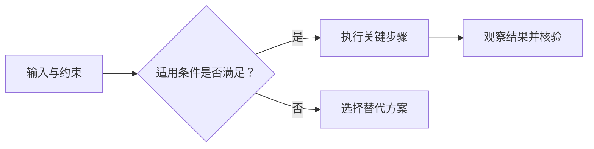

# 领域知识简报 Skill 设计方案

状态：Skill 与存储脚本已在 `skills/knowledge-brief/` 实现，CLI 行为测试通过；已安装到当前项目的 `.agents/skills/knowledge-brief/`，尚未创建定时任务。使用方法见 [README](../README.md)。

设计一个适用于不同探索领域的 **`knowledge-brief` Skill**：用户通过关键词和说明表达学习需求，每次生成一篇围绕具体问题的知识简报，并把全文、来源和选题依据保存到持久历史中，供后续选题去重。本方案独立定义配置、默认规则、生成流程、模板和留痕要求。

## 1. 目标与边界

核心目标是：**每天理解一个问题，读完能解释一个机制、改进一个做法，或判断一个说法是否可信。**

本设计作出四个明确约定：

1. **内容可配置。** 探索范围由用户提供的关键词和说明决定，可以组合多个相关主题，不设默认领域。
2. **每个输出目录每天一篇。** 日期按北京时间计算；重复调用返回当天已有结果。
3. **成功简报永久留痕。** 后续运行必须读取真实历史，不能依赖聊天上下文记忆。保存不等于已经备份，不默认同步到云端或提交 Git。
4. **新意按学习内容判断。** 不把换标题、换表达、换一个说明同样结论的例子算作新内容。

这里的“不重复”指：在同一个输出目录的已生成历史中，没有实质重复的学习内容。无法承诺内容对用户而言从未见过；用户可用反馈标记“已掌握”。如果没有合格题目，宁可记录失败，也不伪造新意。因此不承诺任何条件下每天都能出刊。

首版采用文件存储和一个辅助脚本，不引入数据库、向量服务、后台服务或独立推送系统。

## 2. 用户如何使用

Skill 支持四类请求，以下是自然语言交互示例；存储 CLI 命令见 Skill 内的存储契约：

| 请求 | 行为 | 可验证结果 |
|---|---|---|
| “配置知识简报，我想探索统计学和实验设计” | 创建六项配置并初始化历史目录；补齐默认值 | 展示关键词、说明、语言风格、来源说明、输出目录和模板 |
| “按这份配置生成今天的简报” | 读取配置与历史，检索、去重、写作、归档 | 返回当天简报与本地文件链接 |
| “查看最近一个月学了什么” | 查询历史 | 列出日期、问题、结论与全文入口 |
| “这篇太浅了，下次讲深一点” | 将反馈关联到指定简报 | 保存反馈，后续选题和深度参考它 |

首次只需提供想探索的关键词，其余使用默认值。日常运行必须指定或已经绑定唯一的配置文件；存在多个配置且无法确定使用哪一个时，才请求用户选择。

**Skill 承担一次生成工作；调度器负责每天触发。** 建议初始设为每天北京时间 09:00。自动执行前验证：宿主能加载 Skill、能联网阅读来源、能访问同一份持久历史、能向用户展示结果。任何一项未验证，都只能说明手动生成可用，不能宣称每日自动运行已完成。

本轮不创建调度任务。后续实现时先跑通手动生成与历史复用，再接入用户选择的调度环境。

## 3. 配置设计

采用 JSON 文件，**只保留六项用户配置**。探索范围和偏好用自然语言表达，不再拆成领域、读者画像、权重、字数和选题参数。

示例配置：

```json
{
  "keywords": ["统计学", "数据分析", "实验设计"],
  "description": "关注统计方法的原理、实际用法和常见误区。每天围绕一个具体问题学习，理解方法及适用边界。",
  "style": "准确、简洁、通俗易懂，用具体例子解释，区分事实、观点与推断。",
  "source": "优先阅读原始研究、权威机构资料和可信的一手实践文章。可用媒体发现线索，关键结论追溯原始资料，排除纯营销内容。",
  "output_dir": "./briefs",
  "template": "./brief-template.md"
}
```

| 配置项 | 作用 |
|---|---|
| `keywords`：关键词 | 用户想探索的主题，可填写多个关键词或短语 |
| `description`：说明 | 用自然语言说明关注什么、想解决什么问题、哪些内容不感兴趣 |
| `style`：语言风格 | 描述希望的表达方式，如通俗、严谨、简洁、少术语 |
| `source`：来源说明 | 用自然语言描述来源要求，可直接包含偏好的网站或链接，不要求维护结构化来源列表 |
| `output_dir`：输出目录 | 保存简报及其历史记录的位置，也是跨日去重的历史范围 |
| `template`：简报模板 | 指向可编辑的 Markdown 模板文件，控制简报的栏目与组织方式 |

使用规则：

- `keywords` 至少包含一个非空关键词；`description` 未提供时可留空，不编造用户背景或目标。
- 未指定 `style` 时，默认“准确、简洁、通俗易懂，用具体例子解释，区分事实、观点与推断”；未指定 `source` 时，默认“优先原始研究、权威机构资料和可信的一手实践，关键结论追溯原始资料，排除纯营销内容”。没有单独的语言、字数或读者配置。
- `output_dir` 默认 `./briefs`。未提供模板时，将内置模板复制到配置文件旁的 `brief-template.md`，供用户直接编辑；不覆盖已有模板。
- 输出目录和模板路径均相对于配置文件所在目录解析。自动任务必须访问同一份历史和模板；找不到既有文件时不能静默换目录或退回默认模板。
- 修改关键词、说明、风格、来源或模板后，仍对照同一输出目录的全部历史。同一天已发布的简报不因此覆盖重写。
- 不同配置使用同一输出目录时共享历史，并遵守每天一篇；需要独立简报时使用不同输出目录。不再增加学习路径编号或领域标识。
- 反馈影响选题，不擅自改写用户配置；持久配置调整由明确的配置请求执行。

每天一篇、完整历史去重、留痕与证据核验都是 Skill 的固定行为，不增加开关。调度时间由调度器设置，日期固定按北京时间计算。

## 4. Skill 与历史文件结构

仓库中的实现位于 `skills/knowledge-brief/`：

```text
knowledge-brief/
├── SKILL.md
├── references/
│   ├── brief-template.md
│   └── store-contract.md
├── assets/
│   └── config.example.json
└── scripts/
    └── brief-store.mjs
```

- `SKILL.md`：触发条件、四类请求、执行流程、来源要求、去重判断和失败条件。
- `references/brief-template.md`：内置默认模板，初始化时复制为用户模板；日常生成读取配置中的模板文件。
- `references/store-contract.md`：内部 CLI 命令、草稿记录结构与失败恢复方式，生成时按需读取。
- `config.example.json`：配置样例，不承担实际用户状态。
- `brief-store.mjs`：负责配置校验、历史读取、发布落盘、索引重建和反馈追加。模型负责理解和写作，脚本负责可确定的文件行为。

用户数据与 Skill 安装目录分开保存，更新 Skill 时不替换历史：

```text
<配置文件目录>/
├── knowledge-brief.config.json
├── brief-template.md
└── briefs/                         # output_dir
    ├── .store.json                # 已初始化标识
    ├── .lock                      # 运行期间存在
    ├── .drafts/                   # 未发布草稿
    ├── 2026/11/2026-11-06/
    │   ├── brief.md
    │   └── record.json
    ├── index.jsonl
    ├── feedback.jsonl
    └── runs/
        └── <run-id>.json
```

以上日期仅为目录示例，路径均从配置推导。

### 保存什么

| 文件 | 内容与用途 |
|---|---|
| `brief.md` | 用户实际收到的完整简报，含图表和来源链接；使用外部图片时一并归档 |
| `record.json` | 日期、时区、运行标识、领域、主题、学习问题、结论、去重摘要、来源和当次配置快照 |
| `index.jsonl` | 从成功简报记录派生的精简索引，供选题读取；可重建，不是唯一历史 |
| `feedback.jsonl` | 反馈时间、目标简报、原始反馈及“太浅、太深、已掌握、想继续”等标签 |
| `runs/<run-id>.json` | 每次生成尝试的状态、时间、候选题及取舍摘要、错误原因、最终产物位置 |

`record.json` 中必须包含：

- `brief_id`、`business_date`、`timezone`、`generated_at`；时区由固定日期规则写入记录，不是用户配置。
- `topic`、`learning_question`、`learning_outcome`、`key_claims`：回答了什么、学到了什么、依据什么。
- `content_type`：新进展或经典知识；`related_brief_ids` 与 `new_learning_delta`：与历史有关时，具体新增了什么。
- `dedup_review`：最相近的历史简报、通过或拒绝的理由，以及核验时使用的历史范围。保存简短决策依据，不保存模型内部推理。
- `sources`：实际阅读的 URL、规范化 URL、标题、机构或作者、发布日期、访问时间、版本信息及支撑的结论。未知发布日期明确记为未知。
- `config_snapshot`、当次模板内容快照、Skill 版本、简报正文摘要哈希；便于复核生成条件与发现完全相同的正文，不把哈希当作语义去重。模板快照避免用户修改模板后丢失当时的写作条件。

只保存必要的来源元数据和自行归纳的证据，不默认镜像整篇网页。首次初始化建立空历史；正常生成只读取已有历史。历史损坏或失联必须先修复，不能当成首次运行。

## 5. 如何让每天有实质新内容

### 5.1 去重分为三种判断

| 判断 | 规则 | 执行方式 |
|---|---|---|
| 当天是否已经生成 | 同一输出目录下，同一日期只有一个成功发布的简报 | 脚本确定性检查；存在则返回原文 |
| 是否重复报道同一材料 | 规范化 URL、论文标识与版本帮助识别转载、跟踪参数和同一证据 | 脚本标记来源重合，模型判断内容贡献 |
| 是否重复讲同一件事 | 比较学习问题、核心结论、机制、证据与适用条件 | 模型对照完整历史索引，必要时读相近全文 |

URL 规范化只移除已知跟踪参数，保留会影响资源身份的路径、参数和版本。来源重合不是直接淘汰条件：同一本教材或同一篇论文可以支撑多个不同问题。

**语义去重不能靠随机标题或正文哈希实现。** 首版不引入向量库；使用结构化历史摘要进行比较。如果历史超出一次可读范围，分批扫描完整索引并汇总近似项，不能悄悄只看最近几天。不能完成必要比较时，本次停止发布。

同日最多一篇可以由脚本保证；语义新颖性仍依赖模型判断，无法证明永远零误判。设计以完整历史、明确增量和保守拒绝约束它，遇到无法确认的近似内容时换题或停止，不能把行为验收通过描述为绝对的新颖性保证。

### 5.2 重访旧主题必须有可说明的增量

| 候选内容 | 处理 |
|---|---|
| 昨天讲过假设检验，今天换个标题再次解释相同过程 | 拒绝 |
| 换了来源和演示案例，学习结论与适用条件完全相同 | 拒绝 |
| 已讲过假设检验的基本流程，今天学习多重检验为何增加误报及如何控制 | 可接受：问题、判断方法与学习成果有变化 |
| 同一项技术出现新证据，改变了此前的适用边界或选择建议 | 可接受：引用旧简报，明确哪条认识被补充或修正 |
| 只是“更深入”但说不清新增了什么 | 拒绝 |

候选题必须先写清三个字段，再进入正文写作：

1. `learning_question`：今天究竟回答哪个具体问题？
2. `learning_outcome`：读完能新增什么解释、操作或判断能力？
3. `new_learning_delta`：与最相近历史相比，新增了什么？首次涉及该问题时标明首次覆盖。

只有新措辞、新例子或新链接，不能作为增量。相同主题允许连续学习，但必须通过上述判断。

### 5.3 选题从历史出发

先查看已覆盖内容与反馈，再围绕关键词和说明选择有缺口的方向，不设置领域权重。优先寻找近期有价值的新证据，没有合格新材料时，选择未覆盖的经典问题，明确标注“经典知识”。

检索新进展时，先关注最近 72 小时，必要时扩大到一周，再考虑经典问题。一次运行最多评估 5 个候选题，仍无合格题目则留存失败记录，避免无限搜索和换标题凑数。这是内部执行规则，不暴露为选题配置。

## 6. 一次生成如何执行

```text
加载六项配置、模板与确认历史位置
  → 检查当天是否已有成功简报
  → 获取输出目录的生成锁，复查当天结果
  → 读取并核对历史索引、相近全文与反馈
  → 检索候选并实际阅读来源
  → 生成学习问题、学习成果及增量说明
  → 跨日去重与证据审核
  → 按模板撰写简报与图表，复核关键结论及图文一致性
  → 发布完整归档，更新索引与运行记录
  → 返回全文和归档链接
```

### 来源与内容审核

依据 `source` 的自然语言说明寻找资料，每篇回答四个问题：

1. **问题是什么？** 在什么场景和约束下，需要解决什么问题？
2. **机制是什么？** 方法改变了哪个环节，为什么可能有效？机制尚不明确时直接说明。
3. **证据是什么？** 哪些是事实或实验结果，哪些是作者观点、推断或未知？
4. **边界是什么？** 何时适用、何时不适用，有什么成本与替代方案？

用户指定某个来源也不免除证据审核：

- 技术内容优先原始论文、官方文档、作者代码与实验资料；其他领域按同样原则寻找原始研究、权威数据或一手材料。
- 媒体和社交内容可用于发现线索，关键判断尽量回到原始材料。无法回到原始材料时，明确证据限制，必要时换题。
- 官方发布证明其发布内容，不自动证明效果优势；性能数字必须带任务、对照和条件。
- 明确区分事实、作者观点、推断与未知。未经运行的例子标记“示意”，不能称为实测。
- 通常使用 2–4 条实际阅读的来源，不为数量凑引用；每个关键结论都要能找到支撑，或明确标注为推断。
- 经典知识检查版本和适用性；“经典”不意味着免于核验。

### 落盘、重复运行与恢复

1. 日界线按北京时间计算，运行开始时固定 `business_date`，跨午夜完成也归属启动日期。
2. 同一输出目录只允许一个生成进程持有锁。其他调用检查当天结果；尚未生成时返回“正在生成”，不启动第二次生成。
3. 在输出目录下的临时目录写齐 `brief.md` 与 `record.json`，校验后整体重命名到当天目录；当天目录存在时禁止覆盖。
4. **完整日目录发布成功才算生成成功。** 之后更新可重建索引和运行记录，再返回结果。通知失败不撤销已经归档的简报。
5. 发布后索引更新失败，下次从日目录重建并返回当天结果；不能再写一篇。读取历史时核对日目录与索引，历史缺失或内容损坏则停止。
6. 锁贯穿一次生成的多次 CLI 调用，以运行标识关联所有者，在发布或失败处理完成后释放。崩溃后先确认原调用已结束，再用同一运行标识执行失败处理；已有完整归档时恢复为成功。无法确认原调用是否结束时停止，不按超时时间直接抢占。临时草稿不作为成功历史。

首版要求存储支持可靠的独占创建和同一文件系统内的目录重命名，并验证该行为。多个执行环境共享历史时必须共享这份存储及锁；不能各存一份再宣称全局去重。首版先验证单一运行环境，不承诺分布式并发协调。

运行状态只需 `running`、`succeeded`、`reused`、`failed`。失败记录区分配置错误、历史不可读、来源不可核验、无新题目和归档失败等原因；不生成看似成功的占位简报。

复用当天结果前也要确认归档完整且正文哈希一致，损坏时报告错误。存储不可写、无法保存运行记录时，直接向调用方返回失败及“记录未落盘”，不能宣称留痕成功。

## 7. 简报输出模板

下面是内置默认模板。用户可编辑 `template` 指向的 Markdown 文件，调整栏目、顺序和表达要求；每次生成均读取该文件，不使用写死的栏目覆盖用户模板。语言风格以 `style` 为准，模板主要控制内容结构。

来源可追溯、区分事实与推断、重访主题说明增量是固定内容要求。自定义模板未提供对应栏目时，在合适的位置自然补充，不强制恢复默认标题；模板与这些要求直接冲突时报告冲突。

### 图表呈现规则

**涉及多步流程、条件判断、逻辑关系或对象交互时，用图表辅助说明关键关系，配简短文字解释。** 图表放在对应内容旁，不单独堆在文末；单一事实或一句话就能说清的内容无需配图。不增加图表配置项，这些要求直接写入默认模板。

| 内容 | 呈现方式 | 需要说清什么 |
|---|---|---|
| 操作流程、条件分支、状态变化 | Mermaid 流程图 | 输入、关键步骤、分支条件、输出；存在循环时画出返回路径 |
| 逻辑链条、因果或依赖关系 | Mermaid 关系图 | 节点与箭头的含义；区分相关、因果与假设，不能用箭头把推测画成事实 |
| 多个角色或系统之间的交互 | Mermaid 时序图 | 谁在何时向谁传递什么，先后顺序及关键返回结果 |
| 方法、方案或适用条件的差异 | Markdown 对比表 | 使用统一的比较维度，突出差异、成本和选择条件 |
| 有实际数据支撑的数量或趋势 | 数据图或数据表 | 单位、范围和来源；没有可靠数据时不编造数值 |

图表应满足：

- 根据当天内容绘制，节点使用具体概念，不能每天复用同一张泛化示意图。
- 图文一致，关键分支不遗漏；示意、推断和未知关系明确标注。
- 一张图围绕一个问题，复杂内容拆图；配一句话说明读者应看懂什么。
- 默认使用 Mermaid 和 Markdown 表格。交付时检查阅读端能否正常显示；不支持 Mermaid 时渲染为 SVG 或 PNG，在正文引用并将图片与图表源文件一同归档，不能只留下无法显示的代码块。
- 无法确认显示时，在交付状态中说明，不把缺少本地渲染工具当作阅读器不支持的证据。工具探测和渲染诊断不写进知识正文。

### 默认模板正文

````markdown
# 知识简报｜YYYY-MM-DD
## 一个具体、值得回答的问题

领域｜新进展 / 经典知识｜预计阅读 3–5 分钟

**核心结论**
用 1–2 句话直接回答问题，保留成立条件。

### 问题与机制
说明场景、限制，以及方法为什么可能有效。
首次出现的必要术语用一句话解释；机制未知就说明未知。

涉及逻辑、流程、分支或交互时，在这里绘制与当天问题对应的图。
下面仅为条件流程的结构示意，生成时替换为具体内容；交互用时序图，比较用表格。



用一句话解释图中最关键的关系或分支，并说明适用条件。

### 一个具体例子
通过同一任务解释关键差别，给出判断结果的方法。
未经实际运行的例子标注“示意”。

### 证据与边界
说明证据支持到哪里、仍有哪些未知、何时不适用，以及成本与替代做法。
存在多个方法或适用条件时，用对比表呈现；数量结论有可靠数据时，使用数据图或表并注明来源。

### 今天可以试什么
一个 3–5 分钟的小实验或思考题，写清观察方法与判断标准。

### 与之前有什么不同
仅在关联旧主题时出现：链接旧简报，说明本次新增或修正的认识。

### 来源
列出实际阅读的原文、作者或机构、发布日期，并说明支撑哪个关键结论。
未知日期直接标注，不猜测。
````

首次覆盖无需增加“与之前有什么不同”栏目。生成完成后附本地归档入口；历史查询可汇总学习路径，不把已生成自动记为已掌握。

## 8. 实施顺序与验收

按三个阶段推进，每个阶段都有可观察的结果：

| 阶段 | 交付 | 验收重点 |
|---|---|---|
| 1. 手动生成闭环 | Skill、配置、文件存储辅助脚本、模板 | 配置可读，能生成一篇有来源的简报，全文与记录一致 |
| 2. 历史约束与行为验证 | 历史查询、去重、反馈、失败与恢复处理 | 重复调用不多发，跨日换标题不绕过去重，历史缺失时停止 |
| 3. 每日自动运行 | 选定宿主的调度配置与一次真实触发证据 | 新会话仍读取同一历史，按北京时间归档，结果可访问 |

阶段 1 的生成结果仅作人工试用；通过阶段 2 后，才进入持续出刊试运行，并继续观察语义重复是否有遗漏。

必须覆盖以下验收场景：

| 场景 | 预期结果 |
|---|---|
| 首次仅输入关键词 | 补齐其余配置并提供默认模板，生成一篇并保存完整归档 |
| 配置多个关键词与探索说明 | 每篇聚焦一个问题，选题符合说明并参考历史缺口 |
| 修改语言风格或来源说明 | 后续简报的表达和来源选择遵循新说明 |
| 编辑模板文件 | 后续简报采用新栏目与顺序，并保留来源和增量说明 |
| 主题涉及流程、判断分支或对象交互 | 生成对应流程图或时序图，条件和顺序与正文一致 |
| 主题涉及方案对比或数量趋势 | 选择对比表或有来源的数据图表，不编造数值 |
| 阅读端无法渲染 Mermaid | 使用可显示的图片，正文引用有效，图片与源文件均已归档 |
| 两份配置指向同一输出目录 | 共享历史和每天一篇的约束，不各自重复发布 |
| 同一天手动重试或定时任务重试 | 返回同一归档，成功简报数量仍为一 |
| 同一天修改兴趣范围后再次调用 | 仍返回当天已发布简报；配置变化用于后续日期 |
| 两个生成进程同时运行 | 最多发布一个完整日目录，无覆盖和半份简报 |
| 隔天候选只是更换历史题目的标题或来源 | 被拒绝，改选其他合格问题或记录失败 |
| 重用同一来源，回答不同的学习问题 | 不因 URL 相同直接拒绝，按实际学习增量判断 |
| 旧主题出现改变判断的新证据 | 允许重访，关联历史并写清修正内容 |
| 历史较多，最相近内容在较早日期 | 仍能检出；不能只查最近几天 |
| 正常生成时历史丢失或不可读 | 停止并留存错误，不能当作空历史继续 |
| 发布成功后索引写入中断 | 重建索引并复用当天归档，不重复生成 |
| 来源无法核验或候选全部重复 | 保留失败记录，不生成占位正文 |
| 新会话或自动任务启动 | 使用同一配置与存储，继续既有历史 |
| 反馈“太深、已掌握” | 后续选题可观察到深度或内容调整，旧简报不改写 |

验证需要区分两类证据：配置校验、日期幂等、并发与文件恢复由脚本行为测试证明；语义去重和写作质量用预置历史与候选题的实际 Skill 运行验证，不能用文件存在或关键词匹配替代。

正式接入每日运行前，人工审阅三篇样稿：经典问题、实践方法、前沿证据各一篇。检查是否真的学到一个新判断、来源能否直接支撑结论，以及例子和练习能否执行。

实施完成的标志是：用户能用六项配置表达探索需求、调整模板、手动或按日触发生成、打开历史全文，并观察到重复题目被拦截；不是仅仅生成一个 `SKILL.md` 文件。
