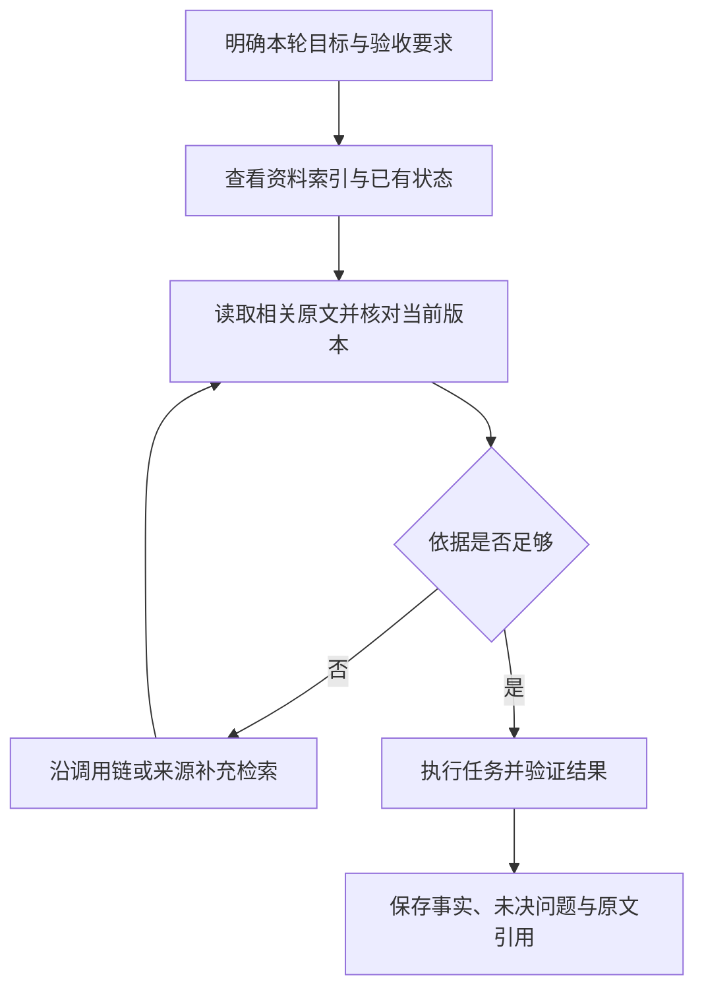

# 知识简报｜2026-11-08
## 上下文装得下，为什么 Agent 仍会漏掉关键信息？

**上下文窗口决定“能放多少”，不保证模型能同样可靠地使用其中每一条信息。** 对持续执行任务的 Agent，值得优化的不只是窗口大小，还包括本轮真正需要哪些事实、事实如何定位，以及下一轮如何找回原始依据。

本篇整理已有研究与工程实践，讨论上下文选择这一未覆盖的问题。与[上一篇](../agent-reliability-pass-at-k/brief.md)的区别是：上一篇讲怎样测量稳定性，本篇讲怎样组织输入，减少无关信息和状态丢失带来的干扰；不把既有实验当作当前模型的排名。

### “信息已经在里面”仍不是充分条件

《Lost in the Middle》在多文档问答和键值检索任务中发现：改变相关信息在输入中的位置，会影响当时被测模型的表现；信息位于开头或结尾时通常更好，位于中间时可能明显下降，即使模型被设计为支持长上下文也是如此。[1]

这是 2023 年模型与特定任务上的发现，不能直接推导所有当前模型都有相同退化幅度。它留下的判断方法仍有用：测试长上下文时，应改变关键证据的位置，而不只测试“能否接受这段输入”。[1]

Chroma 的 2025 年技术报告考察了 18 个模型，测试语义检索、干扰信息、对话问答和重复文本等情形，观察到随输入长度变化的表现并不均匀。其 LongMemEval 子集比较中，人工整理出相关片段的短输入优于包含大量无关历史的完整输入。[2]

这里存在一个实际落差：研究者可以依据标注整理相关片段，生产系统却必须先把它找出来。因此，这不是“把输入压短就一定更好”的证明，也没有给出当前模型通用的最佳长度；检索遗漏和摘要失真同样会造成失败。报告本身也承认没有解释这些退化现象的完整机制。[2]

### 上下文工程的工作，是选择与维护

Anthropic 将上下文工程描述为持续管理模型可见的信息，而不只是改写系统提示词。其文章讨论按需读取：保留路径、链接等轻量引用，在需要时加载原文；同时提醒，运行时探索可能增加延迟，也可能走错方向，需要根据任务组合预先加载和动态检索。[3]

据此可以区分三种组织方式。下表是本篇对实践取舍的归纳，不是经过本地实验得到的优劣排名：

| 方式 | 适合的情况 | 主要代价 |
| --- | --- | --- |
| 直接提供全文 | 资料规模可控，需要跨段综合，遗漏代价高 | 输入成本高；混杂历史可能增加定位难度 |
| 先给索引，按需读取 | 仓库或资料库较大，每次只处理局部问题 | 检索会漏；路径或权限失效会阻断读取 |
| 保存摘要与原文引用 | 跨会话任务，需要快速恢复目标和进度 | 摘要会损失细节，关键判断仍需回查原文 |

这些方式可以组合。短任务没有必要先搭建检索系统；大型代码任务也不必把整个仓库一次塞进模型。

### 以“修复一个接口”为例，该留下什么？

以下是设计示意，未在本项目执行编码实验。

本轮可以先提供目标、验收要求、已定位的入口文件，以及相关日志的位置；随后沿实际调用链补充实现、接口约定与必要测试。若检索只命中了函数名，却漏掉上游参数转换或下游错误处理，输入虽然短，仍不足以支持正确修改。

一份有用的交接记录，可以只保留五类信息：当前目标；已经确认的事实及其来源位置；已修改内容；实际验证结果；尚未确认的问题与下一步。原始日志、完整补丁和详细资料继续保存在文件或 Git 中，通过引用找回。

关键区别在于：**“已确认”必须与“待验证”分开。** 例如“可能由缓存导致”应保留为假设，不能在摘要里变成“根因是缓存”。同样，“实现已写完”不能压缩成“任务已完成”。这两类丢失不靠扩大窗口就能自动避免，需要明确记录状态。

下面是本篇建议的信息组织流程：

图表源文件：[context-selection.mmd](images/context-selection.mmd)。

### 怎么知道是信息组织变好了，而非只是更短？

可以围绕同一个真实任务比较全文输入、检索输入和摘要交接后的输入，固定模型、工具和验收标准，并保留所有运行结果。重点观察三个问题：关键约束是否被遵守；依据能否准确定位且版本正确；任务是否实际完成。Token 数和耗时作为成本一起记录，不作为质量的替代指标。

还应加入会暴露信息选择缺陷的情形：把关键条件放到材料中部；加入看起来相近但已过期的说明；让必要事实分散在多个文件；检查摘要交接后是否把未验证猜测当成结论。这些是本篇提出的测试建议，不是上述研究已经证明对所有 Agent 有效的通用方案。

如果删掉材料后模型更快，却漏掉了一项必要约束，就没有改善该任务。如果质量相当而输入和读取成本下降，才说明这种组织方式在该场景下有价值。目标是提供足够、可追溯的依据，而不是追求最短提示词。

### 来源

1. Nelson F. Liu 等，初稿 2023-07-06，本文参考 v3（2023-11-20）：[Lost in the Middle: How Language Models Use Long Contexts](https://arxiv.org/html/2307.03172v3)。相关信息的位置与长上下文利用实验。
2. Kelly Hong、Anton Troynikov、Jeff Huber，Chroma，2025-07-14：[Context Rot: How Increasing Input Tokens Impacts LLM Performance](https://www.trychroma.com/research/context-rot)。长输入、干扰内容和聚焦输入的技术报告；结果受测试任务与当时模型范围限制。
3. Anthropic，2025-09-29：[Effective context engineering for AI agents](https://www.anthropic.com/research/effective-context-engineering-for-ai-agents)。上下文选择、按需读取及延迟取舍的工程实践。

资料查阅日期：2026-11-08。以上来源均已实际打开阅读；本文没有进行本地模型对比实验。
