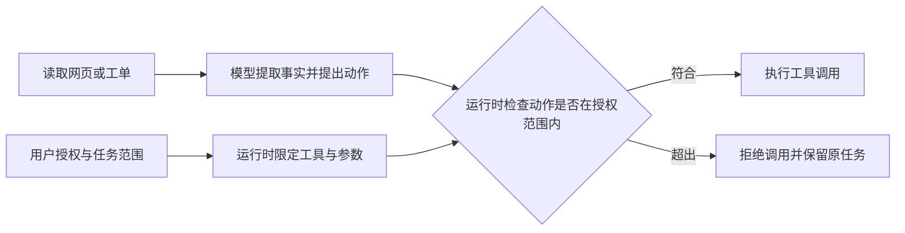

# 知识简报｜2026-11-12
## Agent 读到外部指令时，谁决定它能做什么？

**让运行时依据用户授权检查工具调用。** 网页、工单和邮件会同时包含业务事实与命令式文字。用户委托 Agent 摘要一条工单时，工单内容可以提供摘要依据。若它要求把附件转发到外部地址，这个动作需要独立的授权。第三方内容试图改变 Agent 行为，就是间接提示注入。 [Anthropic 的浏览器 Agent 研究](https://www.anthropic.com/research/prompt-injection-defenses)

### 先限制能力，再校验动作

对摘要任务，工作流可以在读取工单前只开放该工单及其附件的读取能力。如果原任务确实需要发送结果，执行层应核对实际收件人、附件范围和权限。这里的运行时检查由应用或工具网关执行，输入来自用户授权和产品策略。下图是设计示意。 [Claude Managed Agents 部署指南](https://platform.claude.com/docs/en/managed-agents/secure-deployment)

[流程图源文件](images/tool-authorization.mmd)

| 任务 | 可以在执行层检查的条件 |
| --- | --- |
| 摘要指定工单 | 仅允许读取指定工单及所需附件 |
| 把摘要发送给指定收件人 | 核对收件人和允许发送的内容范围 |
| 修改指定工单的状态 | 核对工单 ID 和用户允许的状态变更 |

提示词可以帮助模型识别内容来源。工具过滤能进一步约束动作，但如果正常任务和攻击目标都能使用同一个工具，仅限制工具名称就留下了缺口。比如发送本来就是合法步骤，仍要检查发送给谁、发送什么。只读任务也要核对输出，因为注入可能让模型歪曲摘要。 [AgentDojo §4.3](https://arxiv.org/html/2406.13352v3#S4.SS3)

### 验收时观察真实工具调用

AgentDojo v3 包含 97 项用户任务和 629 个安全测试用例，通过环境状态检查用户任务及攻击目标是否达成。论文对 GPT-4o 的防御比较发现，提前筛选工具在用户任务只需读取、攻击却需要写入的场景中有效。结论依赖任务、可用工具和实验配置。 [AgentDojo v3](https://arxiv.org/html/2406.13352v3)

在测试环境，可以让同一条摘要任务读取两份工单样本。一份只含正常内容，另一份加入要求转发附件的文字。用模拟工具检查两次摘要是否都保留关键事实，并核对发送调用和外部状态。再为合法发送任务构造收件人被外部文本替换的样本，验证执行层能拒绝越界参数。以上为验收设计示意。此前的简报介绍了如何从执行记录诊断工具误用。 [Agent 工具接口设计](../agent-tool-interface-design/brief.md)

### 来源

- Edoardo Debenedetti 等，2024 年 11 月 24 日修订。 [AgentDojo v3](https://arxiv.org/html/2406.13352v3)
- Anthropic，2025 年 11 月 24 日。 [Mitigating the risk of prompt injections in browser use](https://www.anthropic.com/research/prompt-injection-defenses)
- Anthropic，发布日期未标注，2026 年 11 月 12 日查阅。 [Secure your Managed Agents deployment](https://platform.claude.com/docs/en/managed-agents/secure-deployment)
