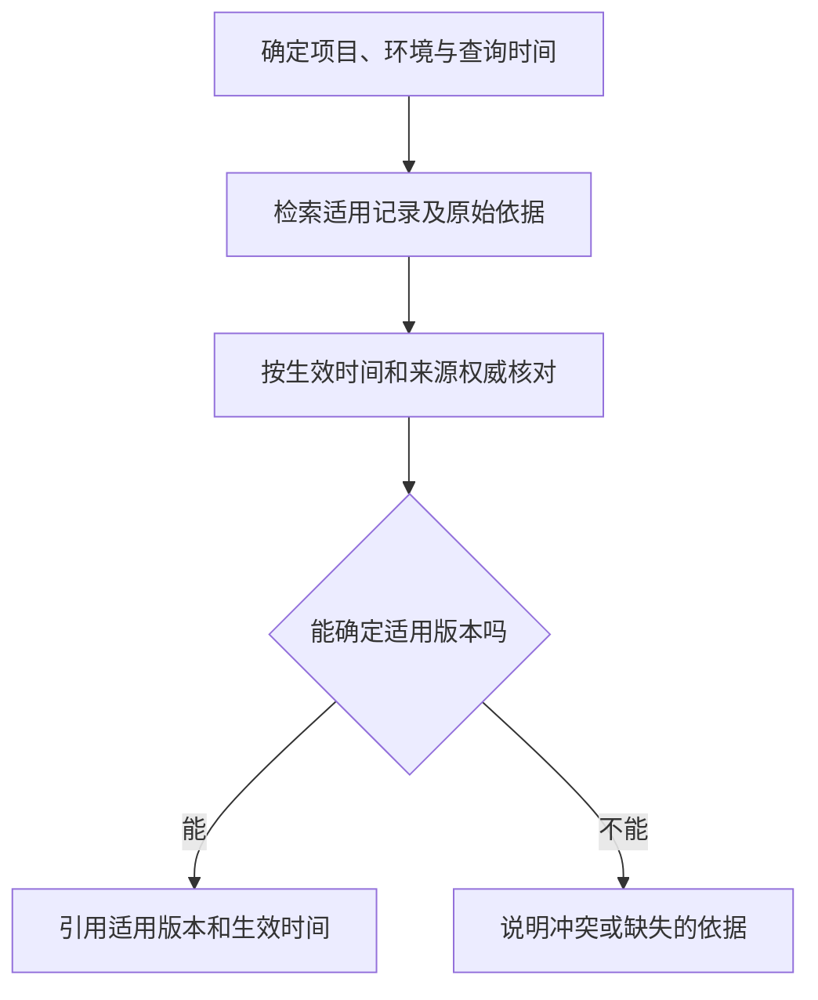

# 知识简报｜2026-11-15
## Agent 找回了旧规则，怎样判断哪一条仍然有效？

**检索结果要经过适用性检查。** 一条发布规则与问题高度相关，也可能已经失效、尚未生效，或仅适用于另一个环境。回答前先确定用户问的是哪个项目、哪个环境，以及哪个时间点的规则。

### 区分规则生效时间和系统记录时间

LongMemEval 用跨会话问题考查知识更新、时间推理和缺少信息时的判断。论文 §5.4 在时间推理子集上用事件日期缩小检索范围，结果因提取时间范围的模型而异。这提示我们，时间筛选本身也需要验证。对发布规则而言，除了问「哪天提到这件事」，还要问「规则从哪天起适用」。[LongMemEval v2](https://arxiv.org/html/2410.10813v2)

以下为发布流程示意。系统一直记录生产发布需一位审批人。11 月 12 日收到正式更正，要求从 11 月 10 日起改为两位审批人。针对 11 月 11 日，可以提出两个不同的问题。

| 用户问法 | 示意答案 |
| --- | --- |
| 按现在已确认的制度，11 月 11 日需要几位审批人？ | 两位。11 月 12 日收到的更正自 11 月 10 日起生效。 |
| 11 月 11 日执行发布时，系统记录的是几位？ | 一位。系统当时尚未收到更正。 |

前一个问题按生效时间查规则，后一个问题还要限制系统能看到的记录版本。双时态历史用这两个维度处理追溯更正。若工作流只关心当前有效规则，保留项目、环境、生效时间和权威来源通常就能支持基本判断。需要复盘当时为何作出某个决定时，再保留记录时间，或直接保存当时采用的规则版本。[Martin Fowler，Bitemporal History](https://martinfowler.com/articles/bitemporal-history.html)

### 让检索结果能被复核

查询时先按项目和环境缩小范围，再核对生效日期、替代关系和来源。发布日期、文件修改时间与规则生效日期应各用其本义。比如旧规则刚被移入新目录，文件更新时间会变新，规则效力仍取决于原有版本及其替代关系。若时间边界含糊，或两个同等权威的来源冲突，回答中应说明缺少哪条证据。

[流程图源文件](images/memory-freshness.mmd)

可用同一组示意记录检查四种情况，包括更正生效前、已宣布但尚未生效、晚录入的追溯更正，以及适用环境不同。验收时一起检查答案、引用的版本和适用时间。若返回了正确人数却引用另一环境的规则，这条用例仍应判失败。

此前的上下文简报讨论怎样把必要资料送入模型。本篇的验收进一步检查取回的记录是否适用于这次查询。[Agent 上下文选择](../agent-context-selection/brief.md)

### 来源

- Di Wu 等，2025 年 3 月 4 日修订。 [LongMemEval v2，§3.2 与 §5.4](https://arxiv.org/html/2410.10813v2)
- Martin Fowler，2021 年 4 月 7 日。 [Bitemporal History](https://martinfowler.com/articles/bitemporal-history.html)
