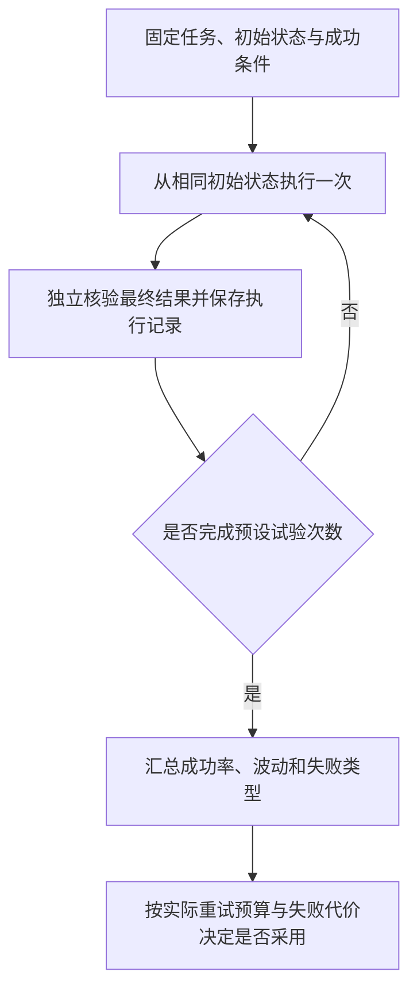

# 知识简报｜2026-11-07
## Agent 多试几次能成功，为什么仍不够可靠？

**“多次尝试中找到一次正确答案”和“每次交付都正确”是两种能力。前者决定 Agent 有没有解题潜力，后者决定工作能否放心交给它。** 只展示一次成功演示，或者只报告重试后的最高成绩，会掩盖真实使用中的不稳定。

[昨日简报](../ai-coding-productivity-measurement/brief.md)讨论 AI 是否节省人工与交付时间；本篇进一步拆解一个前提：我们所说的“成功”，是否可核查、可重复。这里整理既有研究与评测方法，不是今日模型榜单。

### 先看环境里发生了什么

Anthropic 在 Agent 评测指南中区分了执行记录（transcript）与最终结果（outcome）：Agent 说“机票已订好”，只是记录中的一句话；环境里的数据库确实存在预期订单，才是结果证据。评测应同时关注实际产出和必要行为，不能只给最后一段回答打分。[1]

迁移到 AI 编码，下面是本篇提出的验收示意，尚未作为本项目的自动测试运行：

| Agent 的表述 | 可以检查的事实 | 单凭这项事实仍不能证明 |
| --- | --- | --- |
| “文件已生成” | 指定位置存在文件，内容满足约定 | 已经提交到远端 |
| “测试通过” | 预期测试确实执行，结果与日志匹配 | 没有测试覆盖的业务也正确 |
| “已推送 GitHub” | 远端目标分支含预期提交 | 提交内容本身质量合格 |

应根据任务定义足够的检查组合，不是把表中所有检查都加到每个任务。若需求允许多种正确实现，也不应把某一种工具调用顺序误当成唯一正确答案。[1]

### 同一成功率，可以讲出两种完全不同的故事

τ-bench 通过对话结束后的数据库状态判断任务是否达成，并提出 `pass^k` 衡量多次试验全部成功的可靠性。[2] 两个常见指标回答不同问题：

| 指标 | 含义 | 适合回答的问题 |
| --- | --- | --- |
| `pass@k` | 同一任务独立尝试 k 次，至少一次成功的概率；跨任务取平均 | 在有验证器、有重试预算时，能否找到可用解？ |
| `pass^k` | 同一任务独立尝试 k 次，全部成功的概率；跨任务取平均 | 面对重复运行，结果是否稳定？ |

**计算示意，不是实测结果：** 假设某一个任务每次成功概率固定为 p=60%，各次试验相互独立。尝试三次时：

- 至少成功一次：`1 − (1 − 0.6)^3 = 93.6%`。
- 三次全部成功：`0.6^3 = 21.6%`。

看起来接近满分的“多试几次总能成功”，可以和很低的重复可靠性同时存在。这两个数不是同一种通过率，也不能把它们当成当前某个模型的表现。

公式针对固定任务；真实任务难度不同，应分别估计后汇总，不能把全体任务的平均成功率直接代入幂公式。独立试验也不是同一次运行里连续调用三个工具，更不是生产环境连续三天一定可靠的承诺。[2]

重试还有一个实际前提：系统必须识别哪一次成功，且失败尝试的代价可接受。能检查测试结果后选一份补丁，与创建了错误订单后再重试，并不具有相同的产品含义。`pass@k` 本身不包含候选选择器的误判率、失败副作用或额外成本；这些需要另行评估。这是根据指标定义提出的应用判断。

### 为什么小幅涨分可能只是一次好运？

《On Randomness in Agentic Evals》在 SWE-bench Verified 上收集 60,000 条执行轨迹，覆盖三个模型、两个执行框架。研究报告，不同配置下，单轮评测结果的最高与最低值相差 2.2–6.0 个百分点；即使 temperature=0，波动仍然存在。[3]

因此，在该实验设置下，单次测到两三个百分点的提升，可能不足以区分真实改进和随机波动。这里的 2.2–6.0 是研究中观察到的分数范围，不是所有 Agent 的通用误差条，也不能据此断言任何小幅提升都是假的。[3]

实际含义是：改完提示词后一次通过了原来失败的任务，可以作为继续调查的线索；要声称整体更可靠，还应重复运行并报告波动。该论文建议通过多次独立运行估计 `pass@1`，并根据希望检出的效果大小确定评测规模，而不是给所有任务规定同一个重复次数。[3]

### 最小可用做法：固定任务，重置状态，保留所有结果

Anthropic 特别提醒，每次试验应从干净环境开始；遗留文件、缓存或上一轮 Git 历史，可能使不同试验相互影响，从而抬高成绩或制造相关失败。[1]

据此，本篇建议用下面的最小流程比较提示词、模型或 Harness 版本：

图表源文件：[reliability-eval.mmd](images/reliability-eval.mmd)。

每次保存任务编号、版本与运行配置、通过或失败、验证证据和必要成本。超时、工具错误与环境异常也要记录，并预先说明如何计分；若另报排除环境故障后的成绩，应同时给出排除规则与数量，避免只留下成功运行。

优先从真实失败任务和已能稳定完成的任务中各选一部分，前者观察改进，后者观察回归。若评测的是带重试的完整产品，就按生产中的重试上限和验证器一起测；若比较基础 Agent 能力，则把每次独立试验与产品内重试区分开。

**是否采用，取决于交付方式。** 对可验证、可丢弃的候选方案，可以关注多次尝试带来的覆盖；对会修改外部状态、失败代价高的工作，更应关注单次可靠性、重复一致性与失败处理。这里给出的是评测设计建议，尚未在本项目运行模型对比实验。

### 来源

1. Anthropic，2026-01-09：[Demystifying evals for AI agents](https://www.anthropic.com/research/demystifying-evals-for-ai-agents)。结果与记录的区别、评分设计、试验环境隔离。
2. Shunyu Yao、Noah Shinn、Pedram Razavi、Karthik Narasimhan，2024-06-17：[τ-bench: A Benchmark for Tool-Agent-User Interaction in Real-World Domains](https://arxiv.org/html/2406.12045v1)。基于最终状态的评测、`pass^k` 与跨任务汇总定义。
3. Bjarni Haukur Bjarnason、André Silva、Martin Monperrus，初稿 2026-02-06，本文参考 v3（2026-03-25）：[On Randomness in Agentic Evals](https://arxiv.org/html/2602.07150v3)。重复评测中的随机波动及实验规模建议。

资料查阅日期：2026-11-07。以上来源均已实际打开阅读；算例与应用建议已分别注明性质。
