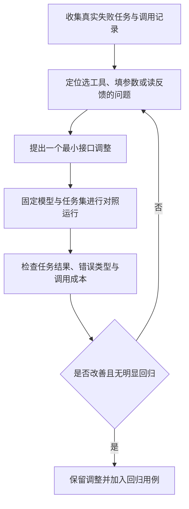

# 知识简报｜2026-11-09
## 工具越多，Agent 为什么反而更难完成任务？

**提供更多工具，只是扩大可选动作；任务能否完成，还取决于 Agent 能否选对工具、正确填写参数，并从结果中判断下一步。** 因此，一次执行失败可能来自工具接口，而不只是模型能力不足。

[上一篇](../agent-context-selection/brief.md)讨论哪些信息应进入上下文；本篇进一步关注动作与反馈的设计：工具是否让模型容易做对、容易发现做错。以下整理既有研究与工程实践，不是今日模型排名。

### 同一个模型，接口也能改变表现

SWE-agent 论文把模型与计算机之间的交互方式称为 Agent-Computer Interface（ACI），既包括可调用的命令，也包括执行后反馈的形式。研究在固定基础模型的设置中设计搜索、浏览和编辑接口，并通过消融实验比较不同方案。[1]

其 SWE-bench Lite 消融实验使用 300 个任务，论文报告专用 ACI 比仅使用默认 Linux shell 的基线多解决 10.7 个百分点的任务。这个结果来自当时的模型和实验环境，不能作为今天任意工具改造的预期收益；它支持的判断是：**评估 Agent 时，模型之外的交互接口也是重要变量。**[1]

论文中的一个具体做法是：编辑后立即反馈文件内容，对选定的语法检查错误给出提示并撤销无效编辑。这样，Agent 能较早发现局部错误，而不必在错误状态上继续工作。这种检查不等于业务正确性验证。[1]

### API 能调用，不代表工具容易使用

Anthropic 的工具设计实践提醒，不应不加选择地把既有 API 端点逐一包装成工具；工具过多或职责重叠，会增加选择困难。其建议是围绕高价值任务提供职责明确的工具，并明确输入、输出与描述。[2]

这不意味着把所有步骤合并为一个万能工具。合并边界应由实际任务决定：哪些调用几乎总是一起出现，哪些步骤需要独立判断，哪些动作会改变外部状态。后两类若被隐藏在同一次调用中，Agent 可能更难控制执行范围。这是本篇对工具组合的设计判断，不是论文给出的通用划分规则。

### 从失败记录找接口问题

以下是本篇提出的诊断表；工具名称与情形为示意，未在本项目实现或运行实验。

| 执行中看到的现象 | 先核对什么 | 可以尝试的最小调整 |
| --- | --- | --- |
| 反复在两个搜索工具间切换 | 搜索对象和范围是否重叠、描述是否矛盾 | 写清哪个搜文件名、哪个搜文件内容 |
| 工具选对了，参数却经常无效 | 参数是否依赖隐含知识 | 将含糊的 `user` 明确为 `user_id` 或 `user_name`，说明来源 |
| 搜到了对象，下一步仍反复查询 | 返回值是否缺少后续调用所需字段 | 同时返回可读名称和稳定标识，不让模型猜 ID |
| 搜索结果太多，直接把前几项当全部 | 分页或截断是否可见 | 返回已截断标记、续页信息或缩小范围的方法 |
| 修改失败后重复相同动作 | 错误是否说明原因与实际状态 | 说明哪些输入不合法、是否已修改，以及可修正的字段 |

Anthropic 也建议通过工具调用记录定位问题：大量参数错误可能需要更明确的说明；冗余调用可能提示分页或结果范围不合适；错误反馈应提供可执行的修正信息。[2]

这些调整都应针对实际失败。没有出现身份混淆，就不必额外设计一套标识映射；一个名称修正能解决的问题，也不必新增模块或工作流。

### 输出要支持下一步决策

设想一个“查找问题单后读取详情”的工具组合。搜索结果若只有内部 ID，模型难以判断哪个对象符合需求；若只有标题，后续详情接口又要求 ID，模型仍需再次查询。更有用的输出通常是能够完成下一步选择与调用的最小信息组合，例如 ID、标题、项目和状态。

这不是字段越少越好。所谓“简洁”，应以不遗漏当前任务的必要信息为前提；不同场景可能需要不同字段。也不必让每个工具都支持复杂的动态字段选择，先确认固定输出是否已足够。

对于写操作，还要区分“请求已受理”和“状态已改变”。错误或成功响应应准确表达工具知道的事实；不能只因返回了一个成功字符串，就让模型推断业务已经完成。这是本篇对结果表达的建议，具体状态仍应按后端契约定义。

### 一次只改一个接口假设

可以沿下面的流程定位改进点，避免同时改模型、提示词与工具后无法归因：

图表源文件：[tool-interface-review.mmd](images/tool-interface-review.mmd)。

比较时以任务最终结果为主，同时观察选错工具、参数错误、重复调用和恢复失败是否减少。工具调用变少而任务遗漏更多，不算改善；同样，一次成功也不足以证明稳定提升。重复运行和保留未用于调参的任务，可参考[前文的可靠性评测方法](../agent-reliability-pass-at-k/brief.md)。

这里提供的是接口诊断方法，没有对本项目或当前模型执行工具改造实验。它最适合处理有迹可循的交互困难；若工具选对、输入正确、反馈完整而推理仍失败，就应继续检查任务难度、提示与模型能力，而不是持续叠加工具。

### 来源

1. John Yang 等，初稿 2024-05-06，本文参考 v3（2024-11-11）：[SWE-agent: Agent-Computer Interfaces Enable Automated Software Engineering](https://arxiv.org/html/2405.15793v3)。固定模型下的 ACI 设计、SWE-bench Lite 消融实验及编辑反馈机制。
2. Ken Aizawa / Anthropic，2025-09-11：[Writing effective tools for agents — with agents](https://www.anthropic.com/research/writing-tools-for-agents)。工具职责、接口描述、返回信息和错误反馈的一手实践。

资料查阅日期：2026-11-09。以上来源均已实际打开阅读；数值仅描述原研究设置，示例和设计建议已注明性质。
