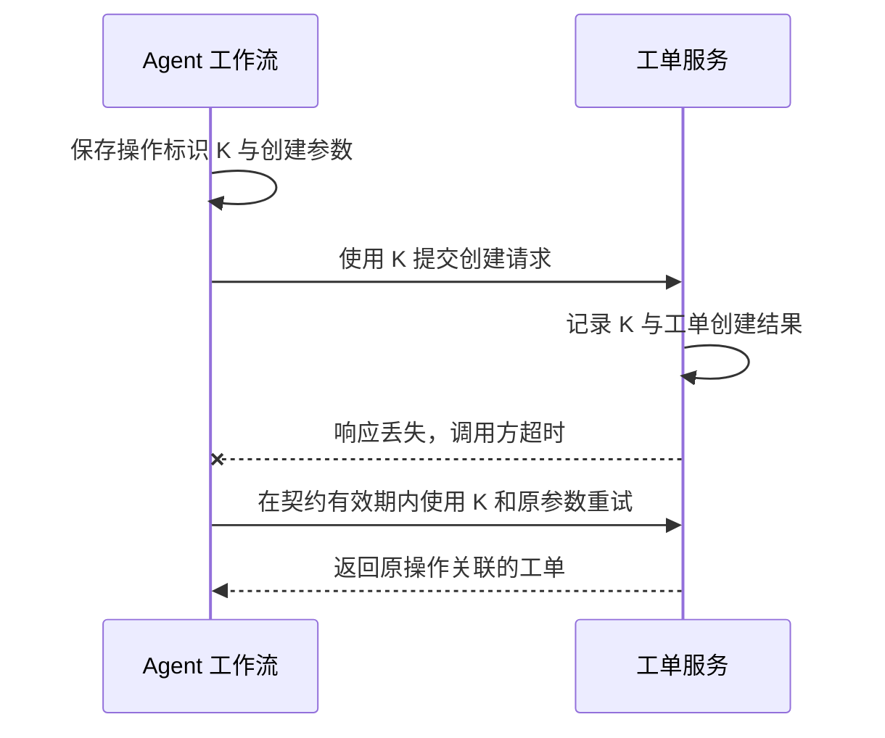

# 知识简报｜2026-11-11
## Agent 写入超时后，怎样安全重试？

**写入工具超时后，先把操作标为「结果未知」。** 服务端可能已经完成写入，只是响应未到达调用方。工作流应保留这次操作的标识，并根据接口约定查询结果或重试。

### 一次业务操作可以对应多次请求

以 Agent 创建一条工单为例（示意）。服务端完成创建后，响应在网络中丢失。如果恢复流程重新发起一次创建，用户可能看到两条工单。调用方若能复用首次请求的幂等键，且服务端在有效期内对该键去重，后一次请求就能关联到同一次创建。两个内容相同的工单也可能来自两次真实需求，因此调用方需要用独立的操作标识表达每次新意图。 [AWS Builders’ Library](https://aws.amazon.com/builders-library/making-retries-safe-with-idempotent-APIs/)

RFC 9110 将幂等性定义在请求的预期效果上。重复执行同一幂等请求，其预期效果与执行一次相同，响应内容可以不同。对非幂等方法，标准建议客户端只有在知道请求语义幂等，或能确认原请求未生效时，才自动重试。支持幂等键的创建接口可以据此提供明确的重试契约。 [RFC 9110 §9.2.2](https://www.rfc-editor.org/rfc/rfc9110.html#section-9.2.2)

### 把标识贯穿到恢复流程

下图是具备幂等契约的工单接口示意。工作流在首次调用前保存标识 K，恢复时沿用 K 和原参数。服务端记录幂等键与业务写入时需要保持一致性，避免工单已写入、去重记录却丢失。AWS 的实践还会拒绝同一键对应不同参数的请求，并定义记录保留期。 [AWS Builders’ Library](https://aws.amazon.com/builders-library/making-retries-safe-with-idempotent-APIs/)

[时序图源文件](images/idempotent-retry.mmd)

| 接口返回或提供的能力 | 工作流如何恢复 |
| --- | --- |
| 支持按操作标识查询，结果显示已完成 | 记录资源 ID，继续下一步 |
| 支持使用原键重试，键仍在有效期内 | 按接口约定复用原键和原参数，处理返回状态 |
| 状态显示仍在处理中 | 按接口约定等待或查询同一操作 |
| 键已过期，或接口无法确认此前是否执行 | 保留结果未知的状态，核对实际记录后再决定是否发起新操作 |

如果查询读到的是延迟更新的数据，一次查无结果仍可能对应正在处理或已经提交的请求。允许补发的条件需要由接口契约明确，比如返回可信的终态，或者仍能使用原键重试。

### 用最终状态验收重试

此前的可靠性简报讨论从干净环境重复执行，估计 Agent 完成任务的概率。生产恢复需要保留首次写入留下的状态，因此验收应覆盖「写入成功后响应丢失」和「进程重启后继续执行」。 [Agent 的重复可靠性](../agent-reliability-pass-at-k/brief.md)

对支持幂等键的创建工具，可在测试环境模拟响应丢失并用同一键重试，核对最终只有一条工单，且恢复后能关联到它的 ID。再用同一键更改参数，检查服务是否按契约返回冲突或校验错误。这些是建议用例，本篇时序为设计示意。

### 来源

- Roy Fielding、Mark Nottingham、Julian Reschke 等，IETF，2022 年 6 月。 [RFC 9110 §9.2.2](https://www.rfc-editor.org/rfc/rfc9110.html#section-9.2.2)
- Malcolm Featonby，AWS Builders’ Library，发布日期未知。 [Making retries safe with idempotent APIs](https://aws.amazon.com/builders-library/making-retries-safe-with-idempotent-APIs/)
