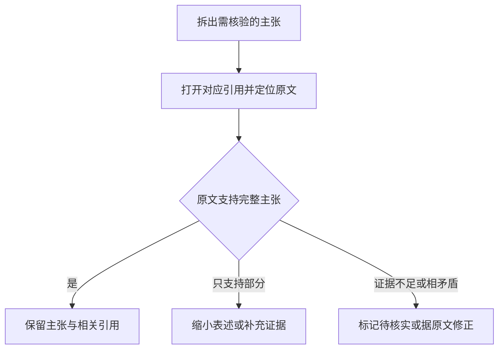

# 知识简报｜2026-11-17
## AI 回答附了链接，怎样检查引用真的支持结论？

**核验引用时，逐条检查原文能否支持回答里的对象、时间、范围和结论。** 一条链接可能只有其中一项的信息。故障公告写着「结算接口的错误率恢复至基线」，可以支撑错误率恢复的说法，却需要额外的证据才能判断是否有订单丢失。

### 把引用覆盖和引用精确分开量

ALCE 在陈述层面计算「引用召回率」。一条陈述至少有一条引用，且所有被引段落合在一起能支持整条陈述，才算覆盖。它也在引用层面计算「引用精确率」，陈述整体得到支持时，一条引用有两种方式得分。它可以独立支持陈述，也可以为其他引用补上缺少的证据。多个来源可以共同支持一条陈述。 [Gao 等，ALCE，§3.3](https://aclanthology.org/2023.emnlp-main.398.pdf)

复核长回答时，可以借用 FActScore 的方法，把复合句拆成各自能验证的最小主张。FActScore 检查每个主张能否从指定知识源获得支持。核验用户看到的引用时，把检查范围先限定在回答实际引用的原文。发现缺口后，再查可信来源补证据。 [Min 等，FActScore，§3.1](https://aclanthology.org/anthology-files/pdf/emnlp/2023.emnlp-main.741.pdf)

### 一条故障摘要怎样复核

以下为示意。AI 写道「结算接口的错误率于 14:20 恢复至基线，订单无丢失」。引用的状态页写着「14:20 现场更新。结算接口的错误率已恢复至基线。」

| 拆出的主张 | 状态页能提供的证据 | 处理 |
| --- | --- | --- |
| 结算接口错误率已恢复至基线 | 正文明确报告已恢复 | 保留，链接到该条更新 |
| 错误率恰好在 14:20 恢复 | 14:20 是更新时间 | 缩小为「14:20 的更新确认已恢复」 |
| 订单无丢失 | 状态页未提供订单处理结果 | 标记待核实，查找订单对账结果 |

按这三个主张计算，原回答只有 1/3 得到所引原文完整支持。这是示意的逐主张覆盖率。ALCE 原论文以陈述为单位评分，整句若作为一条陈述，会因缺少完整支持而记为 0。 [Gao 等，ALCE，§3.3](https://aclanthology.org/2023.emnlp-main.398.pdf)

[流程图源文件](images/citation-verification.mmd)

若用于验收联网问答，可用同一批问题记录「有证据支撑的主张数 / 回答提出的待核验主张数」，同时记录「已回答的必答信息点 / 标注的必答信息点」。第二项指标能发现回答靠省略关键内容获得高覆盖率的情况。自动核验可用于初筛。ALCE 以人工标注为参照，在其样本上对引用召回和精准判定的准确率分别是 85.1% 和 77.6%。新场景可以抽查数字、时间和否定句，观察核验器在哪类陈述上容易误判。 [Gao 等，ALCE，§6 与附录 G.5](https://aclanthology.org/2023.emnlp-main.398.pdf)

### 来源

- Tianyu Gao、Howard Yen、Jiatong Yu、Danqi Chen，arXiv 版修订于 2023 年 10 月 31 日。 [Enabling Large Language Models to Generate Text with Citations](https://arxiv.org/abs/2305.14627)
- Sewon Min 等，arXiv 版修订于 2023 年 10 月 11 日。 [FActScore](https://arxiv.org/abs/2305.14251)
