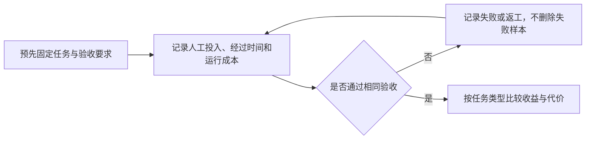

# 知识简报｜2026-11-06
## AI 编码到底省了多少时间？先把等待、审查和返工算清楚

**模型能完成任务，不等于团队能更快交付。衡量 AI 编码收益，应在相同验收标准下，分别记录人的投入、交付耗时和运行成本。** 只看生成代码的速度，或者开发者“感觉省了多少时间”，容易漏掉审查、纠错与交接的代价。

本篇结合已发表研究和工程实践讨论测量方法，不是今日模型排名，也不代表已对本项目做过生产率实验。

### 同一研究的两次结果，提醒了什么？

METR 在 2025 年的随机对照实验中，让 16 名资深开源开发者处理自己熟悉项目中的 246 个真实任务，按任务随机允许或禁止使用 AI。允许 AI 时，主要使用 Cursor Pro 和 Claude 3.5/3.7 Sonnet；任务完成时间平均增加 **19%**。但完成实验后，开发者仍估计自己快了 **20%**。[1]

这个结果只描述当时工具、参与者和成熟仓库的组合，不能直接外推为“现在 AI 编码都会降低效率”。它更稳妥的启示是：**主观省力与实际省时需要分开测量。** 基准测试成绩也不能直接换算成真实项目的提速比例。[1]

2026 年 2 月，METR 披露后续实验的原始结果出现提速迹象，但明确认为这些数据不足以可靠估计当时的真实收益：部分开发者不愿接受无 AI 条件而退出，部分高预期收益任务没有被提交入组；报酬调整也可能影响参与者构成。另有开发者同时运行多个 Agent，单任务投入时间变得难以记录。[2]

**不能把后续结果简单理解为“已经证明提速多少”，也不能继续把 2025 年的 19% 当成当前定论。** 使用方式变化后，测量设计本身也要更新。[2]

### 为什么要同时记录三本账？

下面是基于上述问题提出的团队测量建议，不是两项实验已经验证的统一方案。

| 记录对象 | 建议口径 | 能回答的问题 |
| --- | --- | --- |
| 人的投入 | 从澄清需求到通过验收，所有参与者实际工作的分钟数；包含提示、审查、修复和交接 | 是否真正节省人力？ |
| 交付耗时 | 从任务开始到达到预先约定的验收点，经过的日历时间 | 用户是否更早得到结果？ |
| 运行成本 | 模型调用、工具和计算成本；包月订阅的分摊方式另行注明 | 时间收益是否值得成本？ |

Agent 独立运行期间，人若在做另一项工作，这段等待不应全部算作本任务的人力投入；但它仍可能增加本任务的交付耗时。多人同时审查，应分别计入各人的投入；同一个人同一分钟不能重复归到两个任务。

比较之前还要固定质量门槛：例如同一组功能验收、必要回归检查及代码评审要求。降低测试或审查标准后变快，不能直接解释成同质量下的生产率提升。若 AI 额外改善了文档、测试或功能范围，应单独记录新增价值，避免只比较原始耗时。

### Harness 的价值，要落到可核查的交付证据

Harness 指围绕模型组织工具调用、工作状态、上下文和验证的执行机制。Anthropic 的长任务实践采用初始化与后续编码会话分工，保留功能清单、进度记录和 Git 历史，每次推进一个功能，并用端到端操作确认功能可用。[3]

这是其特定应用开发场景中的工程经验，不是通用提速比例。对团队测量的启发是：**把“完成”的依据留下来，才有可能看见时间花在何处。** 根据这项实践，本篇建议把验收结果、审查修复和运行记录关联到同一个任务，而不是只统计 Agent 产生了多少提交。[3]

图示是本篇提出的测量流程，源文件见 [measurement-flow.mmd](images/measurement-flow.mmd)。

### 在自己的仓库里怎么做一次有效比较？

先限定问题，例如“AI 是否减少熟悉仓库中的小型缺陷修复投入”，不要混合原型开发、大型迁移和日常修复后只给一个平均数。

在任务开始前登记范围、类型、验收点和工具版本；条件允许时，再将符合条件的任务随机分组，避免人主动把擅长的任务交给 AI。明确允许或禁止哪些辅助工具，并记录未完成、退出、失败和范围变化。样本较少时先把结果当作探索性观察，不宣称普遍因果结论。

如果团队已有并行 Agent 工作流，还应同时观察一段时间内通过验收的任务量、总人工投入和质量问题。任务级随机试验适合回答限定问题；它未必能覆盖 AI 改变任务选择、分工和并行方式之后的全部价值。这一限制与 METR 后续实验遇到的困难一致。[2]

最后按结果决定下一步：人工投入下降但交付更慢，可能适合非紧急工作；交付更快但审查投入上升，要判断瓶颈是否转移；只有代码生成更快而验收没有改善，应先分析失败与返工记录，再决定是否增加自动化复杂度。这些是决策建议，实际收益仍需本地数据验证。

### 来源

1. METR，Joel Becker 等，2025-07-10：[Measuring the Impact of Early-2025 AI on Experienced Open-Source Developer Productivity](https://metr.org/blog/2025-07-10-early-2025-ai-experienced-os-dev-study/)。原始随机实验、主观估计与适用范围。
2. METR，Joel Becker 等，2026-02-24：[We are Changing our Developer Productivity Experiment Design](https://metr.org/blog/2026-02-24-uplift-update/)。后续实验的选择效应、并行工作计时困难与方法限制。
3. Anthropic，2025-11-26：[Effective harnesses for long-running agents](https://www.anthropic.com/research/effective-harnesses-for-long-running-agents)。跨会话状态维护、渐进实现与端到端验证实践。

资料查阅日期：2026-11-06。本文使用上述已打开阅读的资料，不声称穷尽截至该日的全部研究。
