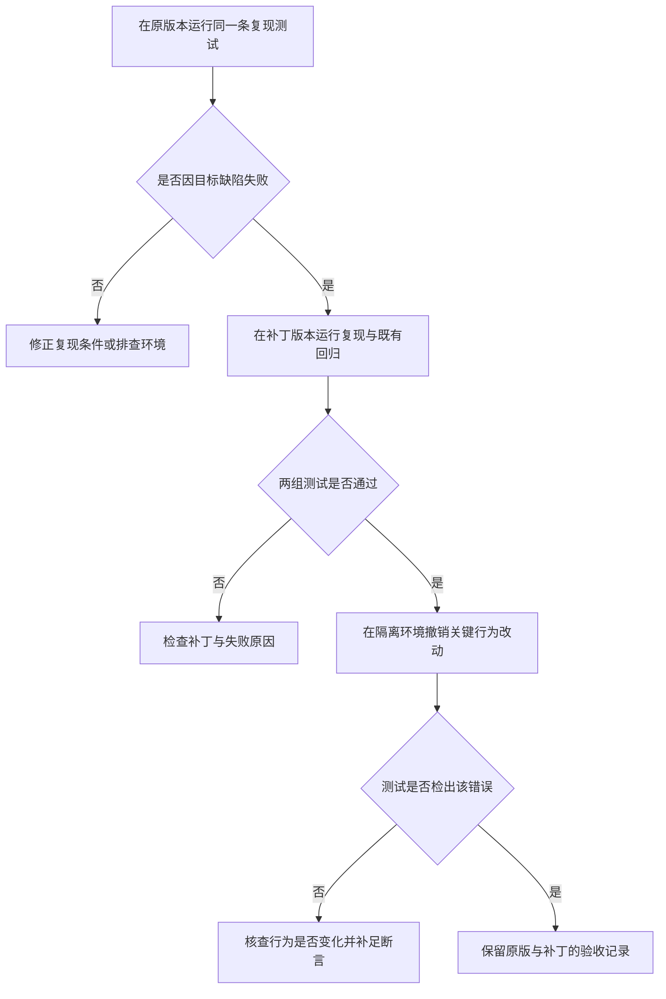

# 知识简报｜2026-11-14
## AI 补丁测试全绿，怎样确认用例能抓住缺陷？

**把同一条行为测试分别跑在原版本和补丁版本上，核对它能否区分错误行为与预期行为。** 原版本应因目标缺陷失败，补丁版本应通过，同时保留原本通过的回归测试。这个顺序能帮助审查者识别只运行了代码、却没有检查关键结果的用例。 [SWE-bench v3，附录 A.4](https://arxiv.org/html/2310.06770v3#A1.SS4)

### 用两组结果验收补丁

| 检查 | 原版本 | 补丁版本 | 说明 |
| --- | --- | --- | --- |
| 缺陷复现 | 因目标行为错误而失败 | 通过 | 验证补丁改变了预期行为 |
| 既有回归 | 通过 | 通过 | 验证已覆盖的正常行为仍可用 |

SWE-bench 把这两组测试称为 `FAIL_TO_PASS` 与 `PASS_TO_PASS`。原论文的判定会核对每项预期测试的状态，缺失项也按失败处理。用于日常开发时，可以同时保存实际执行的用例名与失败断言，以区分业务复现、测试跳过和环境问题。 [SWE-bench v3，附录 A.4](https://arxiv.org/html/2310.06770v3#A1.SS4)

### 用一个刻意错误检查断言

设想搜索接口最多允许返回 100 条结果，旧实现会在请求恰好 100 条时返回校验错误。这是示意场景。只检查响应对象存在的测试，可能在旧实现与补丁上都通过。通过公开接口调用并断言请求成功及返回条数，才能检查此处的业务边界。再检查 101 条请求仍被拒绝，可以发现补丁直接移除上限的情况。

补丁通过后，可以在隔离环境把「大于 100 才拒绝」改回「大于等于 100 就拒绝」，再运行同一套用例。若测试仍通过，先核实改动确实改变了可观察行为，再检查用例是否遗漏边界输入或断言。刻意引入小改动并运行测试，是变异测试的基本做法。Google 的工程实践将变异范围限制在变更且已覆盖的代码，并筛选需要反馈给审查者的结果。 [Practical Mutation Testing at Scale](https://homes.cs.washington.edu/~rjust/publ/practical_mutation_testing_tse_2021.pdf)

[流程图源文件](images/patch-test-evidence.mmd)

### 审查时保留可核对的证据

把复现输入、原版本的失败断言、补丁版本的通过结果和回归范围放在同一份记录里。对关键边界，可以选一个与需求直接相关的错误变体，确认用例会失败。若补丁与验收用例由同一次生成产生，审查者可以直接根据需求重新选择一个输入，检验两者是否共享了同一个错误假设。

此前的可靠性简报用多轮独立运行检查 Agent 能否稳定完成任务。本篇的对照用于检查验收用例能否识别某种具体错误。结果的证明范围由实际运行的用例和检查过的行为决定。 [Agent 的重复可靠性](../agent-reliability-pass-at-k/brief.md)

### 来源

- Carlos E. Jimenez 等，ICLR 2024，v3 修订于 2024 年 11 月 11 日。 [SWE-bench](https://arxiv.org/html/2310.06770v3)
- Goran Petrović、Marko Ivanković、Gordon Fraser、René Just，2021 年在线发表。 [Practical Mutation Testing at Scale](https://homes.cs.washington.edu/~rjust/publ/practical_mutation_testing_tse_2021.pdf)
