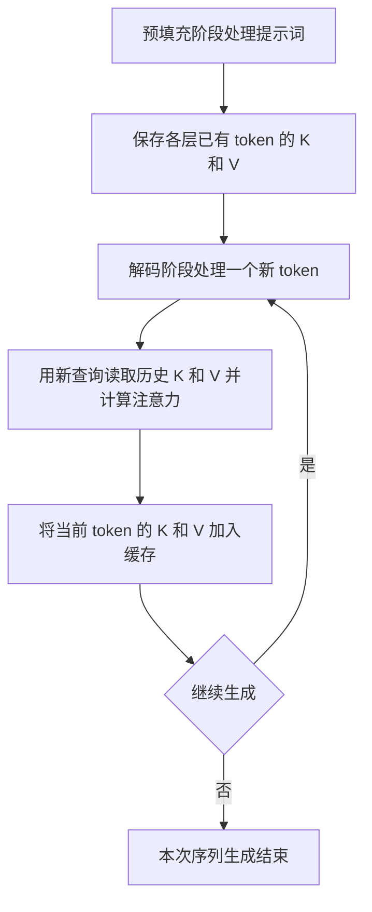

# 知识简报｜2026-11-19
## KV 缓存占多少显存，为什么要看 KV 头数？

**估算标准 KV 缓存容量，要看层数、KV 头数、头维度、缓存精度和仍在保存的 token 总数。** 同样是 32 个查询头，采用 8 个 KV 头的 GQA，在其他条件相同时，其 KV 张量容量为 32 个 KV 头的四分之一。本期回看 GQA 与 PagedAttention 两项经典研究，说明这个估算怎样影响服务容量。 [Ainslie 等，§2.2](https://arxiv.org/html/2305.13245v3)

### 缓存为什么随生成增长

预填充阶段处理提示词并生成各层的键 K 和值 V。解码阶段复用已有 K、V，计算当前 token 的 K、V 并加入缓存，供后续位置使用。提示词和已经处理的输出 token 都会占据缓存位置。 [Kwon 等，§2.2](https://arxiv.org/html/2309.06180v1)

[流程图源文件](images/kv-cache-growth.mmd)

GQA 将查询头分组，同组共享一个 K 头和一个 V 头。因此容量公式使用 KV 头数。MHA 的 KV 头数等于查询头数，MQA 则将全部查询头共享的 KV 头数降为 1。 [Ainslie 等，§2.2](https://arxiv.org/html/2305.13245v3)

### 从张量维度复算容量

以下估算适用于单卡、各层维度相同、完整保留历史且序列之间独立存储的标准缓存。若层数为 L，KV 头数为 Hkv，头维度为 d，每个元素占 s 字节，所有活动序列已缓存 token 数之和为 T，则原始 KV 张量容量约为

`M = 2 × L × Hkv × d × s × T`

系数 2 对应 K 与 V。这个维度计算结合了 PagedAttention 的逐 token 容量分析和 GQA 的共享方式。 [Kwon 等，§3](https://arxiv.org/html/2309.06180v1) · [Ainslie 等，§2.2](https://arxiv.org/html/2305.13245v3)

算例示意，固定 32 层、32 个查询头、头维度 128，KV 使用 FP16，每元素 2 字节。

| KV 头数 | 每条序列已缓存 token 数 | 独立活动序列数 | 原始 KV 容量 |
| --- | --- | --- | --- |
| 32 | 8,192 | 1 | 4 GiB |
| 8 | 8,192 | 1 | 1 GiB |
| 8 | 32,768 | 1 | 4 GiB |
| 8 | 8,192 | 4 | 4 GiB |

8 个 KV 头时，每个 token 占 131,072 字节，即 128 KiB。这些数字是公式计算结果，未运行模型实验。模型权重、临时激活、分配粒度和运行时开销需要另计；跨序列共享前缀、滑动窗口及多卡分片也会改变实际占用。

### 分页怎样影响容量规划

PagedAttention 将缓存分成固定大小的块，按需映射到物理内存，从而减少预留空间与碎片造成的浪费。缓存张量本身的大小仍由其维度决定。部署时可先算每个 token 的容量，再结合输入与输出长度分布、并发量和实测可用缓存空间确定服务上限。 [Kwon 等，§4.1–4.3](https://arxiv.org/html/2309.06180v1)

### 来源

- Joshua Ainslie 等，2023 年 5 月 22 日首发，所读 v3 修订于 2023 年 12 月 23 日。 [GQA: Training Generalized Multi-Query Transformer Models from Multi-Head Checkpoints](https://arxiv.org/abs/2305.13245)
- Woosuk Kwon 等，2023 年 9 月 12 日。 [Efficient Memory Management for Large Language Model Serving with PagedAttention](https://arxiv.org/abs/2309.06180)
