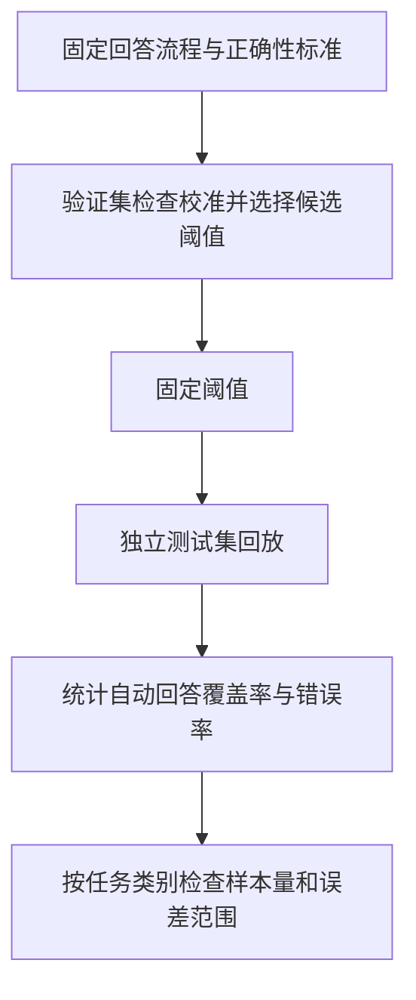

# 知识简报｜2026-11-21
## 模型自报 90% 把握，怎样验证这个数能用于自动放行？

**先用有正确性标注的样本验证置信度，再检查阈值筛出的回答实际错了多少、覆盖多少问题。** 「90%」的校准含义是，在模型给出相近置信度的一组回答中，实际正确率应接近相应的平均置信度。这个关系需要通过一批样本检验。 [Tian 等，§1–2](https://arxiv.org/html/2305.14975v2)

### 自报置信度可以测，提问方式也会影响它

Tian 等在 TriviaQA、SciQ、TruthfulQA 三个短答数据集上比较了多种置信度提取方法。部分被测模型能直接输出具有校准价值的数值，但不同模型的表现有差异，同轮给答案和置信度、分两轮询问也可能得到明显不同的校准结果。论文的实验主要覆盖事实回忆型短答，迁移到长回答或推理任务需要另行评估。 [Tian 等，§3–4](https://arxiv.org/html/2305.14975v2)

业务验证时可固定模型版本、提示词、检索流程与正确性标准，把回答按置信度分组，同时记录每组样本数、平均置信度和实际正确率。样本过少的分组需要更多数据，才能判断观察到的差距是否稳定。

### 自动回答要同时报告覆盖率和错误率

选择性预测研究用覆盖率和选择性风险描述保留部分预测后的表现。将正确性记为对或错时，可以按以下口径计算。 [Geifman 与 El-Yaniv，§2](https://arxiv.org/pdf/1705.08500)

- 自动回答覆盖率 = 达到阈值的回答数 / 全部问题数。
- 自动回答错误率 = 达到阈值且答错的数量 / 达到阈值的回答数。

以下为 1,000 道标注问题上的回放示意，未运行模型实验。低于阈值的问题进入人工复核。

| 自报置信度阈值 | 自动回答数 | 其中答错数 | 覆盖率 | 自动回答错误率 |
| --- | --- | --- | --- | --- |
| ≥ 0.8 | 600 | 60 | 60% | 10% |
| ≥ 0.9 | 300 | 15 | 30% | 5% |

这组示意中，提高阈值减少了自动回答中的错误比例，也使自动覆盖的问题减半。阈值为 0.9 时测得的错误率是 15/300，判断依据来自保留样本的标注结果。

### 用独立样本核对阈值

以下是本文据研究提出的验收流程。先在验证集选择候选阈值，再固定阈值，用独立测试集报告覆盖率、错误率及样本量，避免反复按测试结果调参。可按任务类型检查结果，并给错误率附上统计区间。模型、提示词或问题分布变化后，重新抽样核对。

[流程图源文件](images/confidence-threshold-validation.mmd)

Geifman 与 El-Yaniv 的研究在特定采样假设和阈值选择方法下建立风险控制保证。本文借用其覆盖率与错误率口径衡量问答流程，表中的经验比率只描述这批示意样本。 [Geifman 与 El-Yaniv，§2–3](https://arxiv.org/pdf/1705.08500)

### 来源

- Katherine Tian 等，2023 年 5 月 24 日首发，所读 v2 修订于 2023 年 10 月 24 日。 [Just Ask for Calibration](https://arxiv.org/abs/2305.14975)
- Yonatan Geifman、Ran El-Yaniv，2017 年 5 月 23 日首发，所读 v2 修订于 2017 年 6 月 1 日。 [Selective Classification for Deep Neural Networks](https://arxiv.org/abs/1705.08500)
