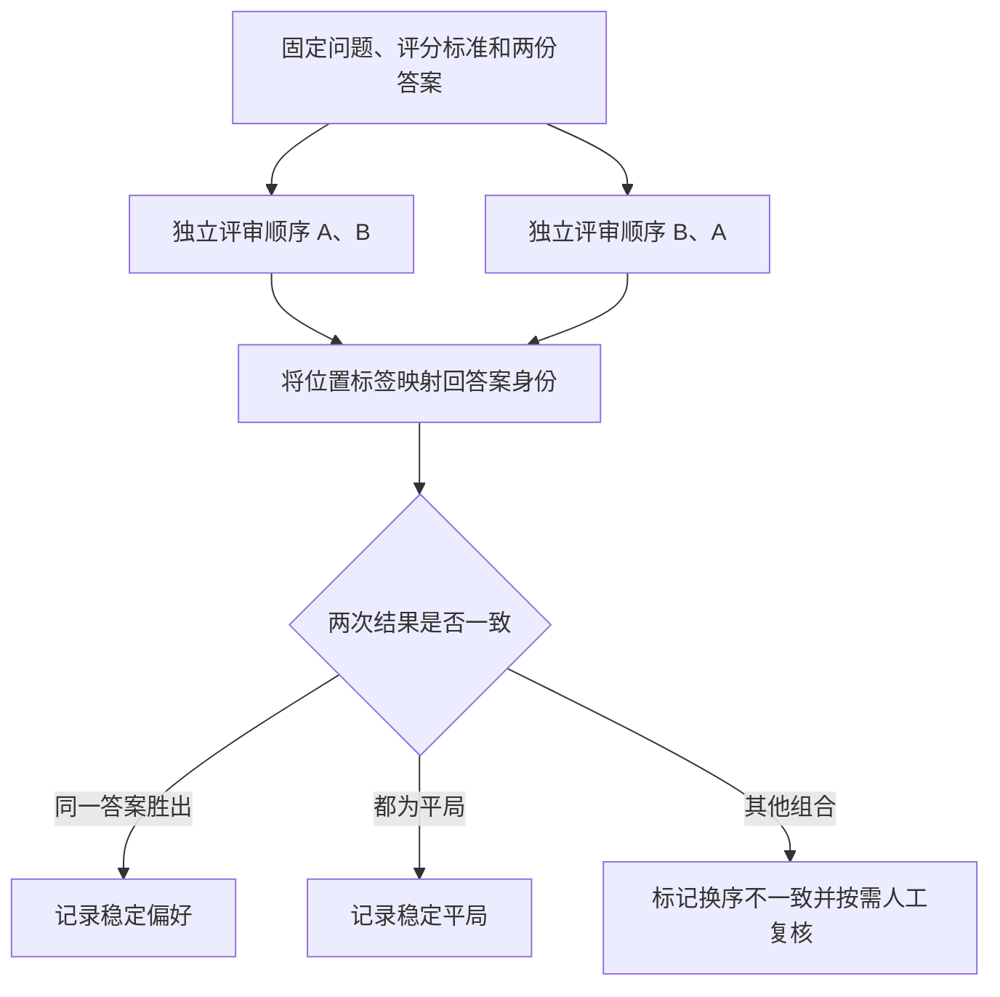

# 知识简报｜2026-11-20
## 让模型比较两个答案，为什么要交换顺序再评一次？

**同一问题、同样两份答案，换个展示顺序，模型裁判可能改变选择。** 用模型评估提示词或回答版本时，可以在两个顺序下独立评审，并把位置标签映射回实际答案，再统计胜负。本期回看两项 2023 年的研究，关注这项评测控制怎样落实。 [Wang 等，§2](https://arxiv.org/html/2305.17926v2)

### 顺序怎样影响评审

Wang 等发现，被测裁判对回答位置存在偏好，偏好的方向随裁判而异。他们提出在不同顺序下评分后取平均值的校准方法，并利用多次判断的分歧选择需要人工参与的样本。 [Wang 等，§2–3](https://arxiv.org/html/2305.17926v2)

MT-Bench 论文给出另一种保守处理。交换两份答案的位置、调用裁判两次，只有同一答案在两个顺序下都获胜，才判其胜出；结果不一致时计为平局。论文同时报告了长度偏好与推理判断错误等局限。 [Zheng 等，§3.3–3.4](https://arxiv.org/html/2306.05685v4)

### 先映射答案身份，再汇总结果

以下是本文据研究提出的评测记录示意，未运行模型实验。固定题目、评分标准、裁判版本和调用参数，第一次展示 A、B，第二次展示 B、A，两次各用独立会话。

| 第一次选择 | 第二次选择 | 映射回答案身份后的结果 |
| --- | --- | --- |
| 第一份 | 第二份 | 两次都选 A，记录 A 胜 |
| 第二份 | 第一份 | 两次都选 B，记录 B 胜 |
| 第一份 | 第一份 | 分别选 A、B，标记换序不一致 |
| 平局 | 平局 | 记录稳定平局 |
| 平局 | 任一答案 | 标记换序不一致 |

保存原始理由、顺序和答案 ID，可以检查裁判是否按同一标准比较。若最终统计将不一致合并为平局，也保留其单独计数，便于复核评测稳定性。

[流程图源文件](images/judge-order-check.mmd)

一次换序后翻转，可以标记为判断不一致。要进一步研究顺序的影响，可在两个顺序下各重复若干次，比较选择分布，并记录相同顺序下自身的波动。这是本文对实验设计的建议，所需调用次数也应计入评测成本。

### 稳定性还要结合人工判断核验

Zheng 等指出，提高换序一致性后，准确性仍需另行检验。应用到业务评测时，可选一批有人工标注的样本，按任务类别核对裁判判断，保留平局和不一致样本。报告中写清胜率分母是否包含这些样本，便于解释不同实验之间的差异。 [Zheng 等，§3.4、§4.2 与附录 D.3](https://arxiv.org/html/2306.05685v4)

### 来源

- Peiyi Wang 等，2023 年 5 月 29 日首发，所读 v2 修订于 2023 年 8 月 30 日。 [Large Language Models are not Fair Evaluators](https://arxiv.org/abs/2305.17926)
- Lianmin Zheng 等，2023 年 6 月 9 日首发，所读 v4 修订于 2023 年 12 月 24 日。 [Judging LLM-as-a-Judge with MT-Bench and Chatbot Arena](https://arxiv.org/abs/2306.05685)
