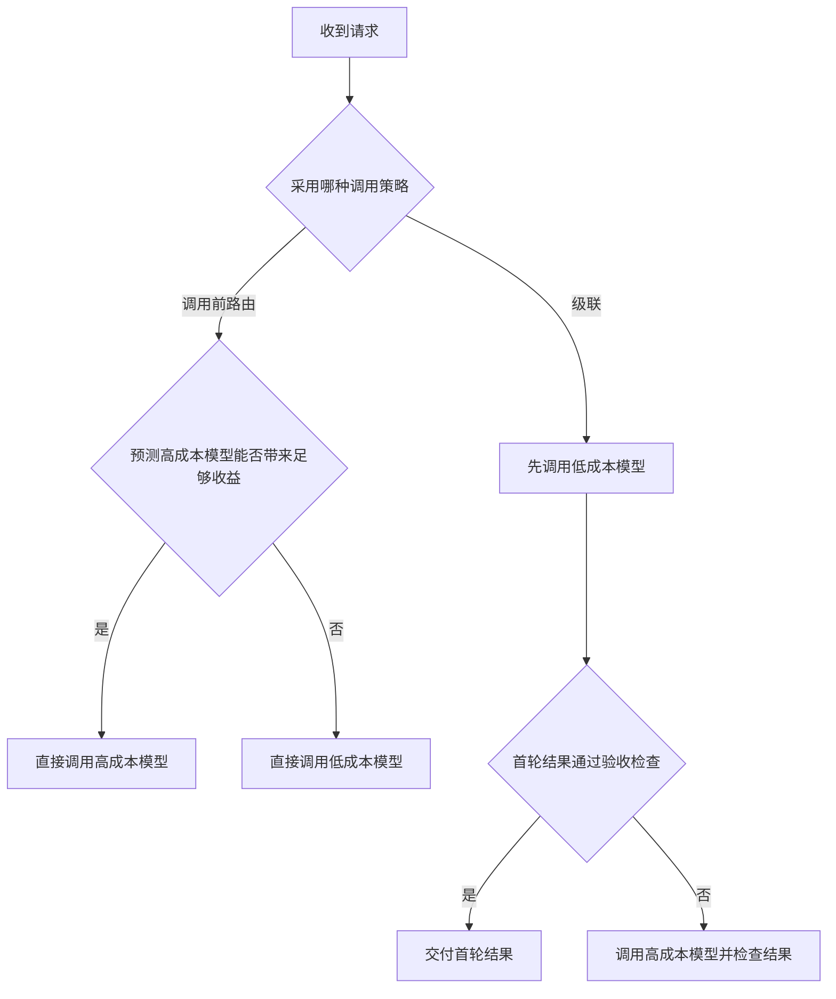

# 知识简报｜2026-11-13
## 模型路由该在调用前选模型，还是在看到答案后升级？

调用前路由用请求本身预测两个模型的表现差异，随后调用其中一个。级联先生成一份低成本答案，再根据验收检查决定是否调用下一档。**选择取决于难例何时能够被识别，以及漏掉难例会造成什么后果。** [RouteLLM §3](https://arxiv.org/html/2406.18665v4) · [FrugalGPT §3](https://arxiv.org/html/2305.05176v1)

### 两种策略能看到的信息不同

| 策略 | 决策依据 | 优先检查的失败 |
| --- | --- | --- |
| 调用前路由 | 请求类别、输入特征，以及模型在类似请求上的历史表现 | 难例被分给低成本模型，或大量易例被送去高成本模型 |
| 级联 | 首轮答案及其验收结果，例如测试或证据核对 | 检查错误地放过坏答案，或重复调用拉长等待时间 |

RouteLLM 用偏好数据学习高成本模型胜出的概率，再用阈值选择模型。FrugalGPT 则对已生成的答案打分，低于阈值时继续调用下一个模型。两篇论文比较的是各自实验里的模型、任务与价格口径。工程评估可以沿用它们的决策方式，再以自己的任务样本校准阈值。 [RouteLLM §3](https://arxiv.org/html/2406.18665v4) · [FrugalGPT §3–4](https://arxiv.org/html/2305.05176v1)

下面是两种策略的流程示意。

[流程图源文件](images/model-routing.mmd)

### 把首轮调用、检查和升级一起计费

假设每次低成本调用花费 1 单位，每次高成本调用花费 5 单位，验收检查每次花费 0.2 单位。这组数值只用于演算，假定单次成本固定，级联最多升级一次。

- 直接调用高成本模型，平均成本为 5。
- 每个请求先走低成本模型和验收检查，若 30% 升级，平均成本为 `1 + 0.2 + 0.3 × 5 = 2.7`。
- 在同样假设下，升级率达到 76% 时，级联的平均成本也达到 5。此时升级的请求还要承担两次串行调用和检查的时间。

这里的 76% 只由示意成本推得。实际调用的输入、输出和工具开销会变动。比较时应按请求累计真实用量，并记录升级路径的耗时。平均成本下降时，最慢的一批请求仍可能变慢。

### 按同一验收标准对照三条路径

可以在一组留出的任务上比较全量使用高成本模型、调用前路由、级联。先确定每类任务的通过条件，再记录以下结果。

| 记录项 | 要回答的问题 |
| --- | --- |
| 各类任务的通过率 | 节省开销的同时，哪些任务的质量发生了变化？ |
| 未升级请求的独立验收失败率 | 在直接交付的结果中，有多少未达到统一质量标准？ |
| 每次交付的总成本与 P95 延迟 | 预算和等待时间能否同时达标？ |

对于编码任务，假如首轮补丁能通过针对目标行为的回归测试，级联就有了一个可检查的升级依据。若验收主要依赖人工审查，可以先按任务类型做调用前路由，再检查各类任务的质量与返工。前文的成本核算还包括开发者等待、审查和返工时间。 [AI 编码收益测量](../ai-coding-productivity-measurement/brief.md)

### 来源

- Isaac Ong 等，2025 年 2 月 23 日修订。 [RouteLLM v4](https://arxiv.org/html/2406.18665v4)
- Lingjiao Chen、Matei Zaharia、James Zou，2023 年 5 月 9 日。 [FrugalGPT](https://arxiv.org/html/2305.05176v1)
