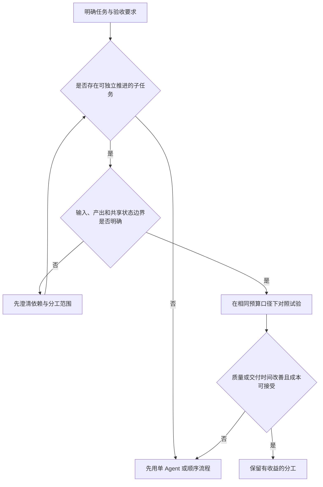

# 知识简报｜2026-11-10
## 多 Agent 的收益，取决于任务能否真正并行

**判断要不要增加 Agent，先看子任务是否能独立推进，再看汇总结果要付出多少协调成本。** 如果每一步都依赖上一轮对共享状态的修改，多几个执行者并不会自动缩短这条依赖链。

[前一篇](../agent-tool-interface-design/brief.md)讨论单个 Agent 如何选工具、填参数和读反馈；本篇转向执行架构：什么时候值得分工，什么时候应保留统一上下文。内容基于已有研究与实践，不是当前模型排行榜，也不是本项目的架构改造方案。

### 成功案例说明了适用场景，也暴露了成本

Anthropic 的研究系统采用主 Agent 协调多个并行搜索分支。其 2025 年文章报告，Opus 4 主 Agent 与 Sonnet 4 子 Agent 的组合，在内部研究评测上优于单个 Opus 4，尤其适合同时探索多个独立方向的问题。[1]

文章同时报告，在其数据中，多 Agent 系统使用的 Token 约为普通聊天的 15 倍；比较基准是聊天，不是单 Agent。因此，不能说“增加 Agent 固定贵 15 倍”。作者也指出，需要共享完整上下文、依赖紧密的工作不适合当时的多 Agent 方案。[1]

这个案例支持的是“某些研究任务可以用更多计算换取覆盖与表现”，不能单独证明同等预算下，多 Agent 普遍优于单 Agent。

### 受控实验发现，任务结构会改变结论

《Towards a Science of Scaling Agent Systems》v3 在六类基准、260 个配置中比较单 Agent 与四种多 Agent 架构，控制工具、提示及计算预算，以研究架构差异。[2]

该版本报告，相对单 Agent 基线，适于拆分的 Finance-Agent 任务中，集中协调架构提升约 80.8%；强顺序依赖的 PlanCraft 任务中，各多 Agent 方案表现下降，其中独立并行方案下降约 70.0%。这些是相对变化，不是增加或减少同等数值的百分点。[2]

这组数字描述特定模型、任务与预算，不能当成实际项目的收益预测。更有用的认识是：**任务本身的并行空间，比“用了几个角色”更能解释分工是否值得。** 同一研究也观察到工具密集任务中的协调负担；并非把角色命名为规划、开发、测试，就能创造独立工作。[2]

版本需注意：2026 年 1 月的 Google Research 介绍采用早期四类基准、180 个配置；本文使用 2026 年 4 月修订的 v3，避免混用不同版本的实验范围。

### 把任务拆成独立产出，而不只是角色名称

下面是本篇提出的判断示意，尚未进行本地对照实验。

| 任务形态 | 是否存在可独立推进的部分 | 更值得尝试的组织方式 |
| --- | --- | --- |
| 从不同资料源核对同一问题，各自返回证据 | 通常有，前提是研究边界和时间口径一致 | 并行搜集，统一核对冲突与汇总 |
| 修改同一条调用链中的共享数据结构 | 往往较少，上下游实现彼此制约 | 先统一接口与顺序实现，再评估局部并行 |
| 对已完成补丁做独立审查 | 可以独立检查，但依赖同一份确定版本 | 固定提交后审查，结论回到统一修复与验收 |

“开发 Agent 等规划 Agent，测试 Agent 等开发 Agent”主要是一条顺序流水线。它可能因职责清晰而有价值，但应测量这种分工实际改善了什么，而不能把角色数量直接换算成并行收益。

即使分工成立，也要明确谁拥有共享状态的修改权、子任务返回什么、分歧如何解决。若每个分支都必须反复读取所有其他分支的进度，原本的局部任务可能重新变成高耦合工作。

### 分工时，最重要的是交付边界

设想要并行检查三个相对独立模块。比“你负责后端，你负责前端，你负责测试”更可核查的委托，是给出具体范围、固定输入版本、要回答的问题、产出格式和停止条件。

每个分支应返回有来源的发现、已验证和未验证的部分，以及需要主流程处理的冲突，而不只是结论。汇总者仍需检查证据、接口一致性与最终行为。多个 Agent 得出相同答案，只能说明输出一致；它们可能共享了同一个错误前提，不能把一致投票当作事实验证。

这些是本篇根据任务依赖提出的设计建议，不是对任一模型可靠分工能力的保证。对于只需几次查询或一次局部修改的问题，先用单 Agent 完成，往往更容易看清实际瓶颈。

### 采用前先问三件事

下面的选择流程是实践建议：

图表源文件：[delegation-decision.mmd](images/delegation-decision.mmd)。

对照试验应同时保留单 Agent 基线，并说明预算是否相同。如果多 Agent 获得更多 Token、更强模型或更多工具，成绩提升只能归于整体配置，不能直接归因于协作架构。

比较最终任务质量、实际交付耗时和全部调用成本，也记录重复工作、信息遗漏与合并返工。如果目标是降低延迟，可以接受更高成本，但应明确这是用资源换时间。若目标是提高可靠性，应沿用[前文的重复评测与结果核验](../agent-reliability-pass-at-k/brief.md)，而不是仅看一次成功演示。

本篇未启动多 Agent 实验，也未改变项目执行架构。最小决策原则是：先证明存在值得并行的工作，再证明协调带来的收益超过其代价。

### 来源

1. Anthropic，2025-06-13：[How we built our multi-agent research system](https://www.anthropic.com/research/multi-agent-research-system)。并行研究系统的一手实践、Token 使用口径及适用条件。
2. Yubin Kim 等，初稿 2025-12-09，本文参考 v3（2026-04-08）：[Towards a Science of Scaling Agent Systems](https://arxiv.org/html/2512.08296v3)。六类基准、260 个配置下的架构与任务匹配研究。
3. Yubin Kim、Xin Liu / Google Research，2026-01-28：[Towards a science of scaling agent systems: When and why agent systems work](https://research.google/blog/towards-a-science-of-scaling-agent-systems-when-and-why-agent-systems-work/)。用于核对早期版本范围，不与 v3 混用实验数字。

资料查阅日期：2026-11-10。以上来源均已实际打开阅读；研究数据、实践观察与本文设计建议已分别说明性质。
