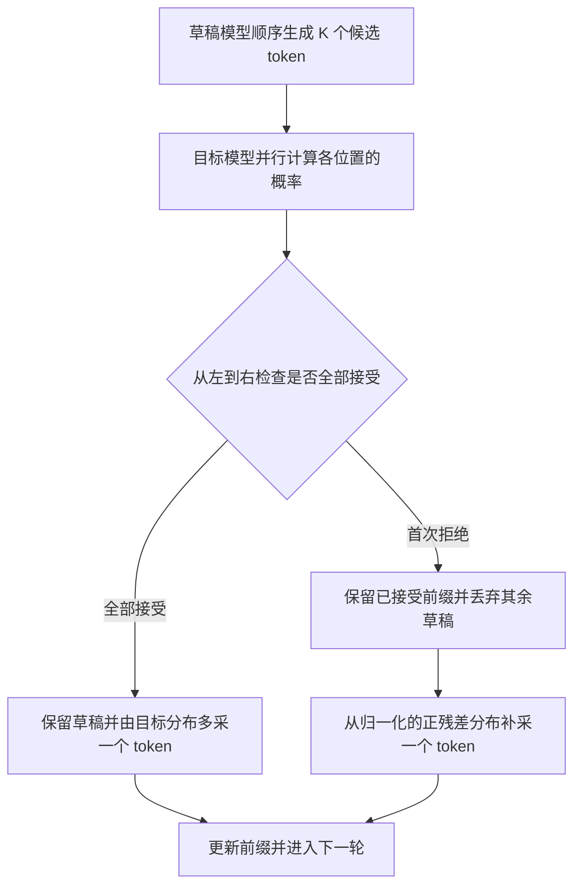

# 知识简报｜2026-11-18
## 推测解码为什么能加速，还能保持目标模型的输出分布？

**小模型先生成几个候选 token，大模型一次并行计算它们的概率，再按接受与补采样规则确定输出。** 推测解码把多轮串行调用合并成一轮验证。它能保持目标模型的采样分布，加速幅度取决于草稿命中情况、草稿耗时和硬件余量。本期回看 2023 年提出这一方法的原始研究。 [Leviathan 等，§2–3](https://proceedings.mlr.press/v202/leviathan23a/leviathan23a.pdf)

### 拒绝草稿之后怎样补齐概率

令同一前缀下，目标模型的分布为 p，草稿模型为 q。候选 token x 从 q 采出，以 `min(1, p(x)/q(x))` 的概率接受。遇到首次拒绝时，保留此前已接受的前缀，丢弃该位置及后续草稿，并从 `max(0, p-q)` 归一化后的分布补采一个 token。如果整段草稿都接受，就再从目标模型的下一位置分布采一个 token。 [Leviathan 等，算法 1 与附录 A.1](https://proceedings.mlr.press/v202/leviathan23a/leviathan23a.pdf)

以下是单位置算例示意。词表只有 A、B，目标分布为 p(A)=0.6、p(B)=0.4，草稿分布为 q(A)=0.8、q(B)=0.2。

| 候选 | 接受概率 | 从草稿直接保留的概率质量 |
| --- | --- | --- |
| A | 0.6 / 0.8 = 0.75 | 0.8 × 0.75 = 0.6 |
| B | 1 | 0.2 × 1 = 0.2 |

拒绝发生的总概率是 0.2。正残差只剩 B，因此拒绝后补采 B，最终得到 A 的概率 0.6、B 的概率 0.2+0.2=0.4，恰好还原目标分布。这个计算依据上述采样规则，未运行模型实验。

[流程图源文件](images/speculative-decoding.mmd)

### 加速取决于哪些条件

Chen 等指出，小批量、内存带宽受限时，目标模型并行计算一小段候选的耗时可以接近生成一个 token。一次验证若保留多个 token，就能摊薄目标模型调用的延迟。在 Chinchilla 70B、16 块 TPU v4、批量 1、草稿长度 4 的实验中，核采样下 XSum 与 HumanEval 的解码加速分别约为 1.92 倍和 2.46 倍。论文也观察到，继续增加草稿长度会让收益趋平或回退。 [Chen 等，§4.1、§6 与图 1](https://arxiv.org/html/2302.01318v1)

这些实验支持的分布保证受硬件数值精度影响。随机数消费顺序和计算图的差异也会让单次输出发生变化。部署验收可固定目标模型和采样参数，对照普通解码，记录每轮保留 token 数、每输出 token 耗时、显存占用及业务质量，并在实际并发下检查吞吐量。 [Chen 等，§6.1](https://arxiv.org/html/2302.01318v1)

### 来源

- Yaniv Leviathan、Matan Kalman、Yossi Matias，ICML 2023，2023 年 7 月。 [Fast Inference from Transformers via Speculative Decoding](https://proceedings.mlr.press/v202/leviathan23a.html)
- Charlie Chen 等，2023 年 2 月 2 日。 [Accelerating Large Language Model Decoding with Speculative Sampling](https://arxiv.org/abs/2302.01318)
