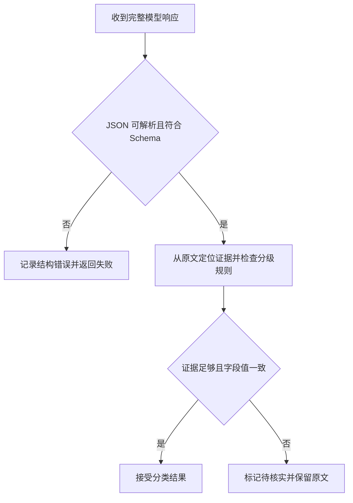

# 知识简报｜2026-11-16
## JSON 通过了 Schema 校验，为什么工单仍会分错级？

**结构化输出可以限制模型填写哪些字段和取值。字段选得对不对，要看原文证据和业务规则。** 如果工单严重级别只允许填 P1、P2 或 P3，模型填写 P1 就能通过枚举校验。团队仍需判断工单描述的影响范围是否达到了 P1 的标准。

### 生成约束管到哪里

JSON Schema 可以声明必填字段、字段类型、枚举和数值范围。约束解码在生成期间根据已生成的内容和约束筛除不合规的候选 token。能约束哪些关键字取决于解码引擎的实现，收到完整响应后仍可用独立校验器核对实际使用的 Schema。 [JSON Schema Draft 2020-12 验证词汇](https://json-schema.org/draft/2020-12/json-schema-validation) · [JSONSchemaBench v3，§5](https://arxiv.org/html/2501.10868v3#S5)

JSONSchemaBench v3 收集约 1 万份实际使用的 Schema，并分别评估效率、约束覆盖和任务质量。论文 §6 用 Llama 3.1 8B Instruct 进行三项推理实验，被测约束解码方案在这些配置下的任务准确率均高于无约束基线。工单分级需要另行衡量，因为模型、约束与验收标准都不同。 [JSONSchemaBench v3，§6](https://arxiv.org/html/2501.10868v3#S6)

### 工单示例中的三道检查

以下为验收设计示意。假设 P1 要求生产环境的关键入口大范围不可用。工单原文只说「测试环境有一名用户无法打开设置页」。即使结果包含合法的工单 ID、P1 和这段原文，分类仍与规则不符。

| 检查 | 示例 | 失败时如何处理 |
| --- | --- | --- |
| 响应能否解析 | 输出在字符串中间截断 | 记录响应不完整 |
| 字段是否符合 Schema | 严重级别填了枚举之外的 P0 | 返回字段校验错误 |
| 字段值是否符合原文和业务规则 | P1 的证据只涉及测试环境 | 保留原文并标记待核实 |

如果产品允许影响范围不明的工单暂缓定级，可在输出结构中明确提供「待核实」及原因字段。否则，强制模型在 P1、P2、P3 中三选一，会让缺少证据的工单也得到一个格式有效的级别。支持证据引用时，可用原文位置或片段定位内容，再校验该证据能否支撑分类理由。

[流程图源文件](images/structured-output-validation.mmd)

上线验收可用同一批标注工单分别统计 Schema 通过率、分级准确率与「信息不足」样本的正确挂起率。加一组格式完全合规、级别刻意填错的样本，确认业务校验能识别它们。若分类还会触发自动派单，执行层需按用户权限和服务规则核对目标。 [Agent 工具授权简报](../agent-indirect-prompt-injection/brief.md)

### 来源

- Saibo Geng 等，2025 年 2 月 27 日修订。 [JSONSchemaBench v3](https://arxiv.org/html/2501.10868v3)
- Austin Wright、Henry Andrews、Ben Hutton 编，2022 年 6 月 16 日。 [JSON Schema Validation，Draft 2020-12](https://json-schema.org/draft/2020-12/json-schema-validation)
